# 🚀 ShanuTechX — Project Architecture Graph

> **Generated:** 2026-07-29  
> **Purpose:** Visual representation of the ShanuTechX cloud platform architecture

---

## 📊 High-Level Architecture Flow

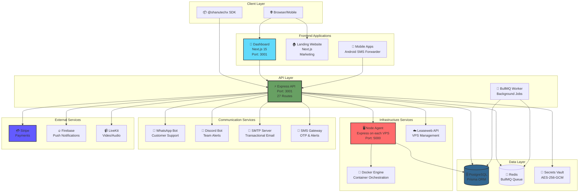

---

## 🏗️ Monorepo Structure

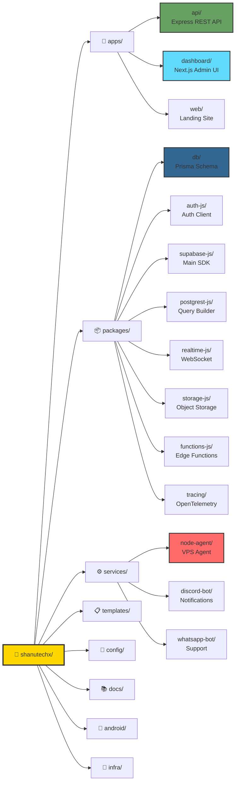

---

## 🔌 API Routes Architecture

```mermaid
graph TB
    subgraph "API Entry Point"
        Entry[🚪 /api<br/>Express Server<br/>Port: 3001]
    end

    subgraph "Middleware Layer"
        Auth[🔐 JWT Auth<br/>verifyToken]
        RateLimit[⏱️ Rate Limiting<br/>express-rate-limit]
        Validation[✅ Zod Validation<br/>Request/Response]
        CORS[🌍 CORS<br/>Cross-Origin]
        Helmet[🛡️ Helmet<br/>Security Headers]
        Roles[👥 Role Guards<br/>requireAdmin/requireDev]
    end

    subgraph "Route Modules - 27 Routes"
        Health[/health<br/>Health Check]
        AuthRoute[/auth<br/>Login/Register]
        Me[/me<br/>Current User]
        
        Projects[/projects<br/>DB Provisioning]
        Deployments[/deployments<br/>Docker Deploy]
        Catalog[/catalog<br/>360+ Templates]
        Domains[/domains<br/>DNS Management]
        
        VPS[/vps<br/>VPS Management]
        Leaseweb[/leaseweb<br/>Leaseweb API]
        Nodes[/nodes<br/>Node Registry]
        Containers[/containers<br/>Docker Ops]
        FS[/filesystem<br/>File Browser]
        
        Billing[/billing<br/>Subscriptions]
        Payments[/payments<br/>Stripe]
        Invoices[/invoices<br/>PDF Generation]
        Orders[/orders<br/>Order Lifecycle]
        Products[/products<br/>Pricing]
        VPSPlans[/vps-plans<br/>VPS Products]
        
        Admin[/admin<br/>User Management]
        Analytics[/analytics<br/>Platform Stats]
        Tickets[/tickets<br/>Support]
        
        SMTP[/smtp<br/>Email Config]
        SMS[/sms<br/>SMS Gateway]
        LiveKitRoute[/livekit<br/>Video Rooms]
        Webhooks[/webhooks<br/>Event Hooks]
        
        AISub[/aiSubscription<br/>AI Features]
        ManagedDB[/managedDatabases<br/>DB as Service]
        APIKeys[/apiKeys<br/>API Key Gen]
        CMS[/cms<br/>Content Mgmt]
        Templates[/templates<br/>Template Editor]
    end

    Entry --> Auth
    Auth --> RateLimit
    RateLimit --> CORS
    CORS --> Helmet
    Helmet --> Validation
    Validation --> Roles

    Roles --> Health
    Roles --> AuthRoute
    Roles --> Me
    Roles --> Projects
    Roles --> Deployments
    Roles --> Catalog
    Roles --> Domains
    Roles --> VPS
    Roles --> Leaseweb
    Roles --> Nodes
    Roles --> Containers
    Roles --> FS
    Roles --> Billing
    Roles --> Payments
    Roles --> Invoices
    Roles --> Orders
    Roles --> Products
    Roles --> VPSPlans
    Roles --> Admin
    Roles --> Analytics
    Roles --> Tickets
    Roles --> SMTP
    Roles --> SMS
    Roles --> LiveKitRoute
    Roles --> Webhooks
    Roles --> AISub
    Roles --> ManagedDB
    Roles --> APIKeys
    Roles --> CMS
    Roles --> Templates

    style Entry fill:#68a063,stroke:#333,stroke-width:3px
    style Auth fill:#ff6b6b,stroke:#333,stroke-width:2px
    style Roles fill:#ffa500,stroke:#333,stroke-width:2px
```

---

## 🎨 Dashboard Application Structure

```mermaid
graph TB
    subgraph "Dashboard App - Next.js 15"
        DashRoot[📱 app/]
    end

    subgraph "Public Routes"
        Login[🔓 /login<br/>Authentication]
        Status[📊 /status<br/>Public Status Page]
        Home[🏠 /<br/>Landing/Redirect]
    end

    subgraph "Protected Routes - (protected)/"
        Protected[🔐 Protected Layout<br/>Auth Required]
    end

    subgraph "Customer Features"
        Dashboard[📊 /dashboard<br/>Overview]
        Profile[👤 /profile<br/>User Settings]
        Cart[🛒 /cart<br/>Shopping Cart]
        OrdersUI[📦 /orders<br/>Order History]
        BillingUI[💳 /billing<br/>Invoices & Payment]
        TicketsUI[🎫 /tickets<br/>Support Tickets]
    end

    subgraph "Infrastructure Management"
        VPSUI[🖥️ /vps<br/>VPS Control Panel]
        VPSPlansUI[📋 /vps-plans<br/>VPS Products]
        ProjectsUI[🗄️ /projects<br/>Database Studio]
        DeploymentsUI[🚀 /deployments<br/>Deploy Manager]
        ServicesUI[⚙️ /services<br/>Service Config]
        CatalogUI[📚 /catalog<br/>Template Browser]
        DomainsUI[🌐 /domains<br/>DNS Manager]
    end

    subgraph "Communication Features"
        SMTPUI[📧 /smtp<br/>Email Settings]
        LiveKitUI[📹 /livekit<br/>Video Rooms]
    end

    subgraph "Admin-Only Features"
        AdminPanel[👑 /admin<br/>Admin Dashboard]
        AdminUsers[👥 /admin/users<br/>User Management]
        AdminOrders[📦 /admin/orders<br/>All Orders]
        AdminAnalytics[📈 /admin/analytics<br/>Platform Stats]
        AdminSettings[⚙️ /admin/settings<br/>System Config]
    end

    subgraph "Developer-Only Features"
        DevPanel[🛠️ /dev<br/>Dev Dashboard]
        DevLogs[📋 /dev/logs<br/>System Logs]
        DevImpersonate[🎭 /dev/impersonate<br/>User Impersonation]
        DeveloperAPI[🔧 /developer<br/>API Keys & Docs]
    end

    DashRoot --> Login
    DashRoot --> Status
    DashRoot --> Home
    DashRoot --> Protected

    Protected --> Dashboard
    Protected --> Profile
    Protected --> Cart
    Protected --> OrdersUI
    Protected --> BillingUI
    Protected --> TicketsUI
    Protected --> VPSUI
    Protected --> VPSPlansUI
    Protected --> ProjectsUI
    Protected --> DeploymentsUI
    Protected --> ServicesUI
    Protected --> CatalogUI
    Protected --> DomainsUI
    Protected --> SMTPUI
    Protected --> LiveKitUI
    Protected --> AdminPanel
    Protected --> DevPanel

    AdminPanel --> AdminUsers
    AdminPanel --> AdminOrders
    AdminPanel --> AdminAnalytics
    AdminPanel --> AdminSettings

    DevPanel --> DevLogs
    DevPanel --> DevImpersonate
    DevPanel --> DeveloperAPI

    style DashRoot fill:#61dafb,stroke:#333,stroke-width:3px
    style Protected fill:#ffa500,stroke:#333,stroke-width:2px
    style AdminPanel fill:#ff6b6b,stroke:#333,stroke-width:2px
    style DevPanel fill:#9b59b6,stroke:#333,stroke-width:2px
```

---

## 📦 Package Dependencies Graph

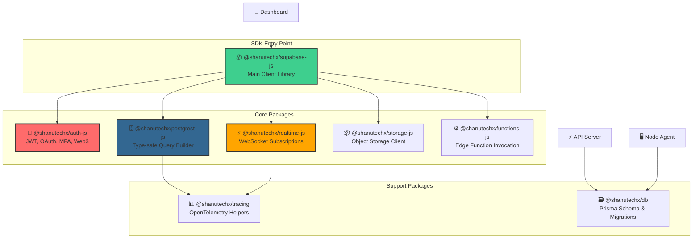

---

## 🔄 Deployment Flow

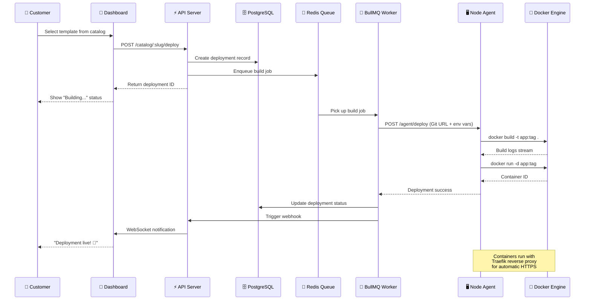

---

## 🔐 Authentication & Authorization Flow

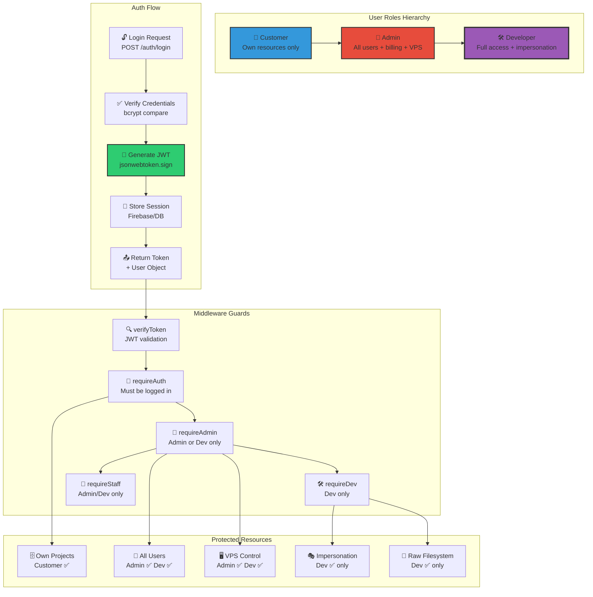

---

## 💳 Billing & Payment Flow

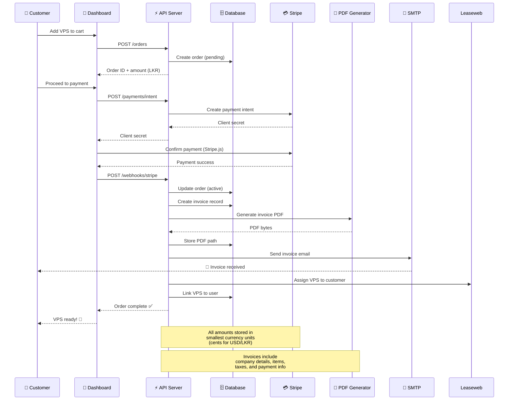

---

## 🗄️ Database Schema Overview

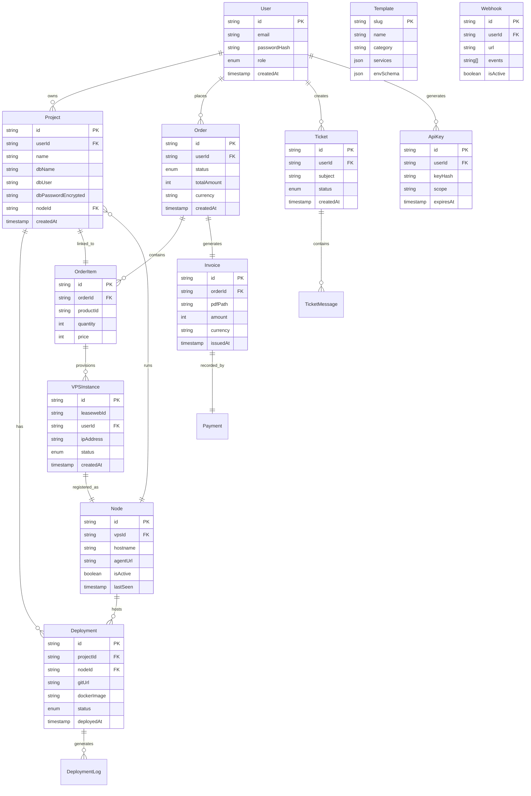

---

## 🌐 Network & Infrastructure Topology

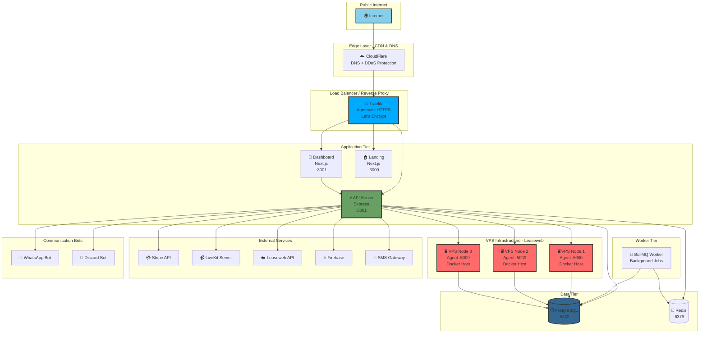

---

## 📋 Template Catalog Categories

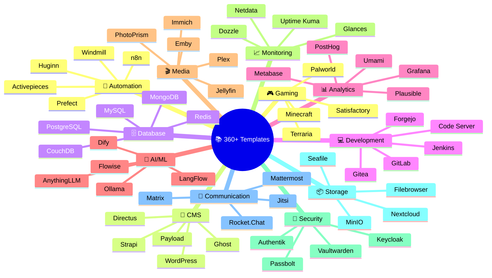

---

## 🔄 CI/CD Pipeline

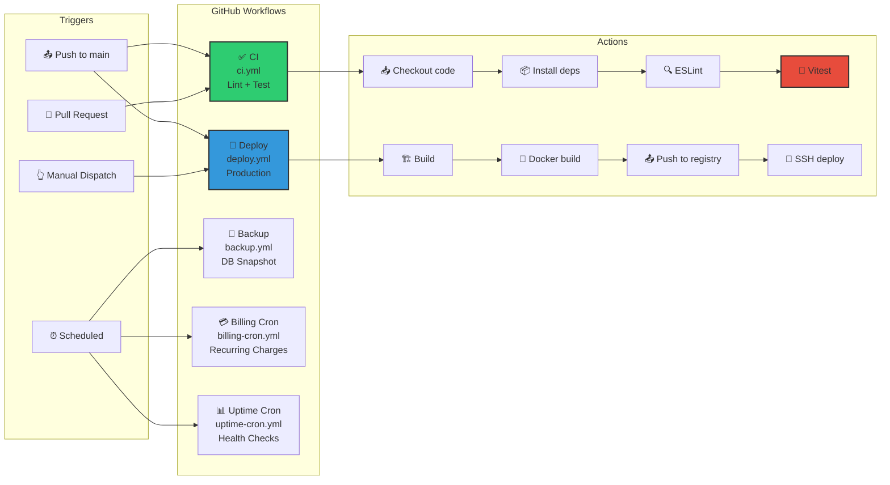

---

## 📱 Communication Architecture

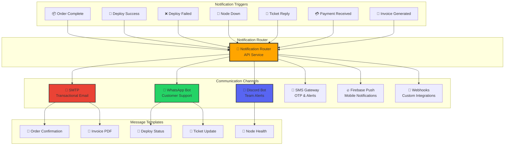

---

## 🔍 Key Technology Stack

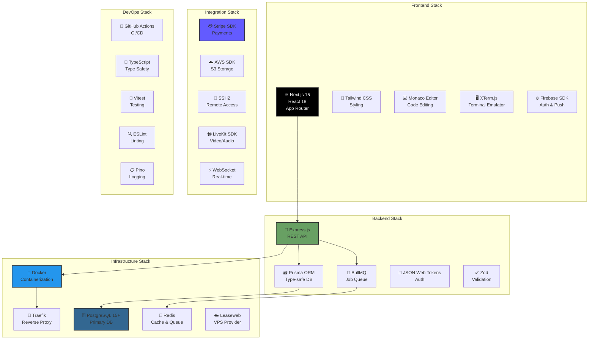

---

## 🎯 Feature Matrix by Role

| Feature | Customer | Admin | Developer |
|---------|:--------:|:-----:|:---------:|
| **Authentication & Profile** | | | |
| Login / Register | ✅ | ✅ | ✅ |
| Update Profile | ✅ | ✅ | ✅ |
| Change Password | ✅ | ✅ | ✅ |
| **Projects & Databases** | | | |
| View Own Projects | ✅ | ✅ | ✅ |
| Create Projects | ✅ | ✅ | ✅ |
| View All Projects | ❌ | ✅ | ✅ |
| Execute SQL Queries | ✅ | ✅ | ✅ |
| Drop Database | ✅ | ✅ | ✅ |
| **Deployments** | | | |
| Deploy from Catalog | ✅ | ✅ | ✅ |
| Deploy from Git | ✅ | ✅ | ✅ |
| View Deployment Logs | ✅ | ✅ | ✅ |
| Stop/Restart Containers | ✅ | ✅ | ✅ |
| View All Deployments | ❌ | ✅ | ✅ |
| **VPS Management** | | | |
| View Assigned VPS | ✅ | ✅ | ✅ |
| Start/Stop VPS | ❌ | ✅ | ✅ |
| Reboot VPS | ❌ | ✅ | ✅ |
| VPS Console Access | ❌ | ✅ | ✅ |
| View All VPS | ❌ | ✅ | ✅ |
| Assign VPS to Users | ❌ | ✅ | ✅ |
| **Billing & Orders** | | | |
| Browse Catalog | ✅ | ✅ | ✅ |
| Place Orders | ✅ | ✅ | ✅ |
| View Own Orders | ✅ | ✅ | ✅ |
| View All Orders | ❌ | ✅ | ✅ |
| Process Payments | ✅ | ✅ | ✅ |
| Generate Invoices | ✅ | ✅ | ✅ |
| View Platform Revenue | ❌ | ✅ | ✅ |
| **Support & Communication** | | | |
| Create Tickets | ✅ | ✅ | ✅ |
| Reply to Tickets | ✅ | ✅ | ✅ |
| View All Tickets | ❌ | ✅ | ✅ |
| Close Tickets | ❌ | ✅ | ✅ |
| **Administration** | | | |
| View All Users | ❌ | ✅ | ✅ |
| Change User Roles | ❌ | ✅ | ✅ |
| Ban/Suspend Users | ❌ | ✅ | ✅ |
| View Analytics | ❌ | ✅ | ✅ |
| Manage Nodes | ❌ | ✅ | ✅ |
| **Developer Tools** | | | |
| Impersonate Users | ❌ | ❌ | ✅ |
| Access Filesystem | ❌ | ❌ | ✅ |
| View System Logs | ❌ | ❌ | ✅ |
| Generate API Keys | ✅ | ✅ | ✅ |
| Manage Webhooks | ✅ | ✅ | ✅ |
| **Real-time Features** | | | |
| LiveKit Rooms | ✅ | ✅ | ✅ |
| WebSocket Updates | ✅ | ✅ | ✅ |
| Chat Widget | ✅ | ✅ | ✅ |

---

## 📊 Platform Statistics (Example)

```
👥 Users:           1,247 (893 customers, 12 admins, 2 devs)
🖥️ VPS Instances:   47 (42 active, 5 provisioning)
🗄️ Projects:        324 (databases provisioned)
🚀 Deployments:     892 (753 active, 139 historical)
📦 Orders:          567 (481 completed, 86 pending)
💰 Revenue (LKR):   12,456,789 (this month)
📧 Templates:       360+ one-click deployable apps
🎫 Open Tickets:    23 (avg response time: 2.3 hours)
```

---

## 🔗 Quick Links

- **Main Repository:** [github.com/yourorg/shanutechx](https://github.com/yourorg/shanutechx)
- **API Documentation:** [api.shanutechx.com/docs](https://api.shanutechx.com/docs)
- **Template Catalog:** [templates/](./templates/)
- **SDK Packages:** [packages/](./packages/)
- **Deployment Guide:** [docs/deployment/](./docs/deployment/)
- **Contributing:** [CONTRIBUTING.md](./CONTRIBUTING.md)
- **License:** [MIT License](./LICENSE)

---

**Generated by Kiro AI • ShanuTechX Platform • 2026-07-29**
