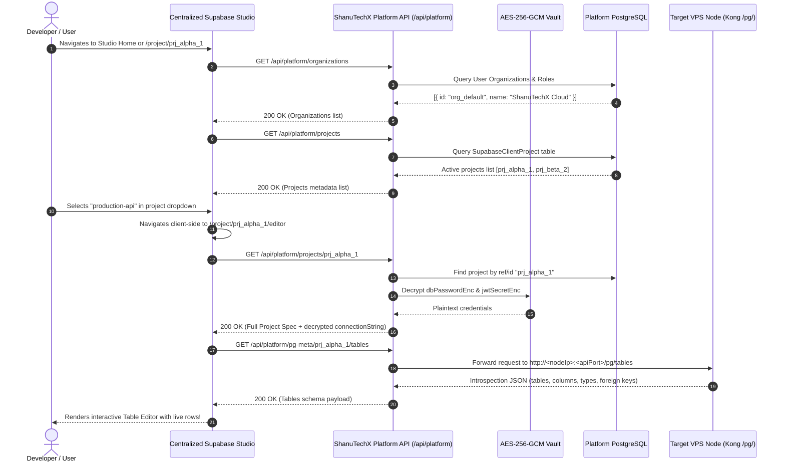
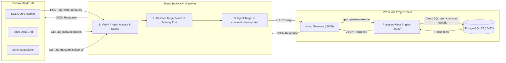
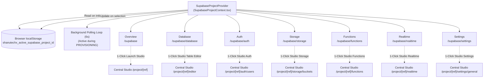
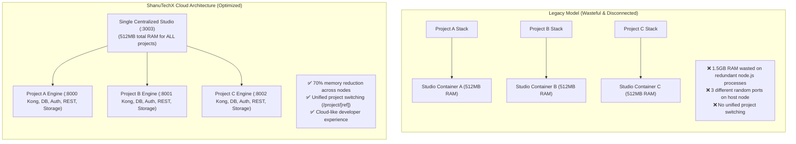
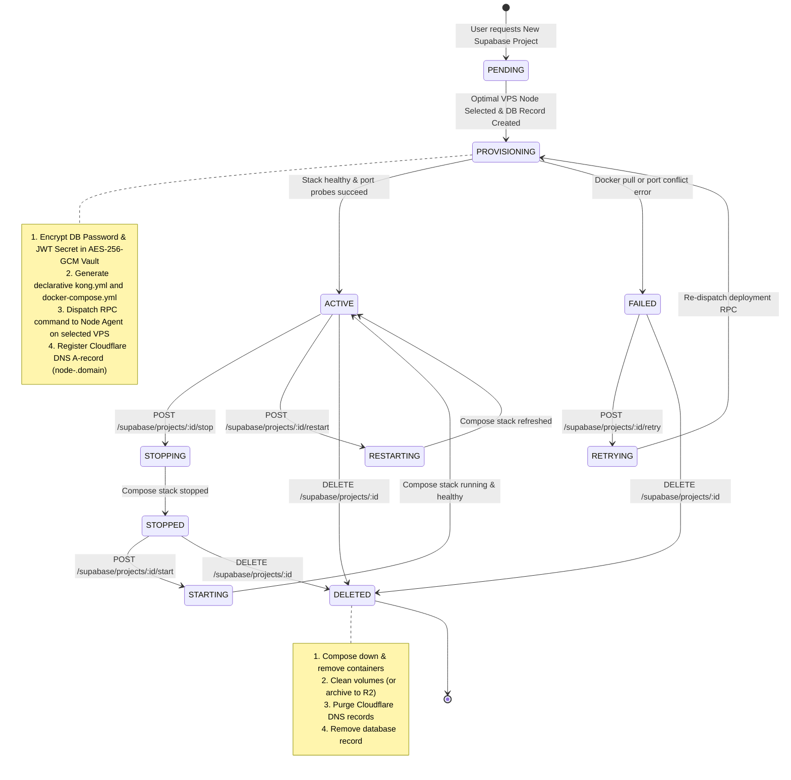
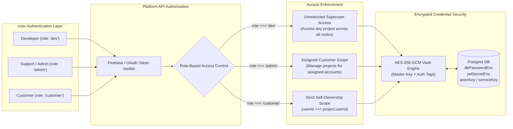

# ShanuTechX Self-Hosted Supabase Cloud Architecture & Workflow Visualization

> **System Blueprint & Operational Flow Manual**  
> Complete technical reference and visual architecture for the ShanuTechX Centralized Supabase Studio Platform, multi-project switching engine, and autonomous VPS container orchestration.

---

## 1. High-Level System Architecture

The ShanuTechX platform transforms self-hosted infrastructure into a cloud-grade Supabase experience (`app.supabase.com` equivalent). Rather than running isolated, disconnected Supabase Studio containers per project on arbitrary ports, a **single centralized Supabase Studio** runs in Platform Mode (`NEXT_PUBLIC_IS_PLATFORM=true`), powered by the ShanuTechX Control Plane API Gateway.

```mermaid
graph TB
    subgraph ClientLayer ["Client & User Experience"]
        DevUser["Developer / Platform Admin"]
        CustUser["Customer / Team Member"]
        Dashboard["ShanuTechX Next.js Dashboard (:3001)<br/>/supabase & subviews"]
        CentralStudio["Centralized Supabase Studio (:3003)<br/>NEXT_PUBLIC_IS_PLATFORM=true"]
    end

    subgraph ControlPlane ["ShanuTechX Control Plane (:4000)"]
        ApiGateway["Express REST API & Gateway (:4000)"]
        StudioPlatformRoute["/api/platform & /platform<br/>(studioPlatform.ts)"]
        SupaRoute["/api/supabase/*<br/>(supabase.ts)"]
        RBAC["RBAC & Security Guard<br/>(dev, admin, customer)"]
        Vault["AES-256-GCM Secrets Vault<br/>(secretsVault.ts)"]
        PlatformDB[("PostgreSQL 16 Platform DB<br/>(Prisma 5.22 Schema)")]
        CFDNS["Cloudflare DNS Engine<br/>(Auto A-Record Tracking)"]
        NodeSelector["Optimal VPS Node Placement<br/>(CPU / RAM / Disk Scoring)"]
    end

    subgraph VPS1 ["VPS Node Alpha (Compute Node)"]
        AgentA["Node Agent Daemon (:5000)"]
        
        subgraph Project1 ["Project: production-api (ref: prj_alpha_1)"]
            Kong1["Kong Gateway (:8000)<br/>Routes: /auth, /rest, /storage, /pg"]
            DB1[("Postgres 15 (:5432)")]
            Auth1["GoTrue Auth (:9999)"]
            Rest1["PostgREST (:3000)"]
            Meta1["Postgres-Meta (:8080)"]
            Realtime1["Realtime Engine (:4000)"]
            Storage1["Storage API (:5000)"]
        end
    end

    subgraph VPS2 ["VPS Node Beta (Compute Node)"]
        AgentB["Node Agent Daemon (:5000)"]
        
        subgraph Project2 ["Project: staging-db (ref: prj_beta_2)"]
            Kong2["Kong Gateway (:8000)<br/>Routes: /auth, /rest, /storage, /pg"]
            DB2[("Postgres 15 (:5432)")]
            Auth2["GoTrue Auth (:9999)"]
            Rest2["PostgREST (:3000)"]
            Meta2["Postgres-Meta (:8080)"]
            Realtime2["Realtime Engine (:4000)"]
            Storage2["Storage API (:5000)"]
        end
    end

    DevUser --> Dashboard
    DevUser --> CentralStudio
    CustUser --> Dashboard
    CustUser --> CentralStudio

    Dashboard -->|"API calls (JWT + x-project-id)"| ApiGateway
    CentralStudio -->|"Platform API (/api/platform/projects/:ref)"| StudioPlatformRoute
    CentralStudio -->|"Introspection (/api/platform/pg-meta/:ref/*)"| StudioPlatformRoute

    ApiGateway --> StudioPlatformRoute
    ApiGateway --> SupaRoute
    StudioPlatformRoute --> RBAC
    SupaRoute --> RBAC
    RBAC --> Vault
    RBAC --> PlatformDB
    SupaRoute --> CFDNS
    SupaRoute --> NodeSelector

    StudioPlatformRoute -->|"Proxy to Kong /pg/ or Meta :8080"| Kong1
    StudioPlatformRoute -->|"Proxy to Kong /pg/ or Meta :8080"| Kong2
    SupaRoute -->|"Compose Up / Restart / Logs"| AgentA
    SupaRoute -->|"Compose Up / Restart / Logs"| AgentB

    Kong1 --> Auth1
    Kong1 --> Rest1
    Kong1 --> Meta1
    Kong1 --> Realtime1
    Kong1 --> Storage1
    Auth1 --> DB1
    Rest1 --> DB1
    Meta1 --> DB1
    Realtime1 --> DB1
    Storage1 --> DB1

    Kong2 --> Auth2
    Kong2 --> Rest2
    Kong2 --> Meta2
    Kong2 --> Realtime2
    Kong2 --> Storage2
    Auth2 --> DB2
    Rest2 --> DB2
    Meta2 --> DB2
    Realtime2 --> DB2
    Storage2 --> DB2
```

---

## 2. Platform Mode & Multi-Project Switching Mechanics

The official Supabase Studio is a Next.js application designed to run in either:
1. **Single-Project Local Mode (`IS_PLATFORM=false`)**: Hardcoded to a single local PostgreSQL database, no project switcher dropdown, no organization selector.
2. **Cloud Platform Mode (`NEXT_PUBLIC_IS_PLATFORM=true`)**: Displays the multi-project selector dropdown, organization hierarchy, multi-user permissions, and routes dynamically to `/project/[ref]/editor`, `/project/[ref]/sql`, `/project/[ref]/database/tables`, etc.

### How Platform Mode Interacts with ShanuTechX API

---

## 3. Postgres-Meta Introspection & Query Proxy Flow

The table below illustrates how every subview in Supabase Studio queries the database through the ShanuTechX proxy layer without requiring direct exposed database ports:

| Studio Subview | Studio Frontend Route | Proxy Endpoint in `studioPlatform.ts` | Target VPS Internal Destination |
| :--- | :--- | :--- | :--- |
| **Table Editor** | `/project/[ref]/editor` | `GET /api/platform/pg-meta/:ref/tables` | `http://<nodeIp>:<apiPort>/pg/tables` |
| **Columns & Views** | `/project/[ref]/database/tables` | `GET /api/platform/pg-meta/:ref/views` | `http://<nodeIp>:<apiPort>/pg/views` |
| **SQL Editor** | `/project/[ref]/sql` | `POST /api/platform/pg-meta/:ref/query` | `http://<nodeIp>:<apiPort>/pg/query` |
| **Database Schemas** | `/project/[ref]/database/schemas` | `GET /api/platform/pg-meta/:ref/schemas` | `http://<nodeIp>:<apiPort>/pg/schemas` |
| **Extensions** | `/project/[ref]/database/extensions` | `GET /api/platform/pg-meta/:ref/extensions` | `http://<nodeIp>:<apiPort>/pg/extensions` |
| **Database Roles** | `/project/[ref]/database/roles` | `GET /api/platform/pg-meta/:ref/roles` | `http://<nodeIp>:<apiPort>/pg/roles` |
| **PostgREST Config** | `/project/[ref]/settings/api` | `GET /api/platform/projects/:ref/postgrest` | Direct synthesis from project credentials |

---

## 4. Dashboard State Synchronization (`SupabaseProjectContext`)

Within [`apps/dashboard`](file:///c:/Users/tiros/OneDrive/Desktop/shanutechx/apps/dashboard), state is kept synchronized through React Context, ensuring the user never has to re-select their project when switching between dashboard tabs or opening official Studio subviews:

---

## 5. Per-Project Compose Stack & Memory Footprint Comparison

### Architecture Comparison

### Complete Service Stack per Project (Running on VPS)

| Container Name | Official Docker Image | Internal Port | Host Port Binding | Role & Responsibilities |
| :--- | :--- | :--- | :--- | :--- |
| `supa-<slug>-db` | `supabase/postgres:15.6.1.139` | `5432` | `dbPort` (e.g. 5435) | Core PostgreSQL database engine with `pgcrypto`, `uuid-ossp`, and `pg_stat_statements`. |
| `supa-<slug>-kong` | `kong:2.8.1` | `8000`, `8443` | `apiPort` (e.g. 8001) | API Gateway routing traffic to Auth, REST, Storage, Realtime, and Postgres-Meta. |
| `supa-<slug>-auth` | `supabase/gotrue:v2.158.1` | `9999` | Internal only | User authentication, JWT issuance, email verification, social OAuth handlers. |
| `supa-<slug>-rest` | `postgrest/postgrest:v12.0.2` | `3000` | Internal only | Instant OpenAPI / RESTful query interface directly exposing PostgreSQL schemas. |
| `supa-<slug>-storage` | `supabase/storage-api:v1.14.5` | `5000` | Internal only | S3-compatible file and object storage with public/private ACL enforcement. |
| `supa-<slug>-realtime` | `supabase/realtime:v2.34.47` | `4000` | Internal only | WebSockets server for real-time Postgres CDC replication and broadcast channels. |
| `supa-<slug>-meta` | `supabase/postgres-meta:v0.84.2` | `8080` | Internal only | PostgreSQL catalog introspection engine queried by Studio via Kong (`/pg/`). |

---

## 6. Project Provisioning & Lifecycle State Machine

---

## 7. Security, Encryption & Multi-Tenant Access Control

---

## 8. Directory & File Implementation Map

| Monorepo Path | Subsystem | Responsibility |
| :--- | :--- | :--- |
| [`apps/api/src/routes/studioPlatform.ts`](file:///c:/Users/tiros/OneDrive/Desktop/shanutechx/apps/api/src/routes/studioPlatform.ts) | Control Plane API | Official Supabase Studio platform endpoints (`/organizations`, `/projects`, `/projects/:ref`, `/pg-meta/:ref/*`, `/profile/permissions`). |
| [`apps/api/src/routes/supabase.ts`](file:///c:/Users/tiros/OneDrive/Desktop/shanutechx/apps/api/src/routes/supabase.ts) | Control Plane API | Project CRUD, Compose builder (`buildSupabaseComposeYaml`), Kong config builder (`buildKongConfigYaml`), node selector, and metrics. |
| [`apps/dashboard/lib/SupabaseProjectContext.tsx`](file:///c:/Users/tiros/OneDrive/Desktop/shanutechx/apps/dashboard/lib/SupabaseProjectContext.tsx) | Dashboard UI | Global project context provider, localStorage synchronization, and background provisioning state poller. |
| [`apps/dashboard/lib/supabaseAdmin.ts`](file:///c:/Users/tiros/OneDrive/Desktop/shanutechx/apps/dashboard/lib/supabaseAdmin.ts) | Dashboard SDK | Typed API client for projects, auth, db, storage, functions, realtime, and `getCentralStudioUrl()` helper. |
| [`apps/dashboard/components/supabase/ProjectSwitcher.tsx`](file:///c:/Users/tiros/OneDrive/Desktop/shanutechx/apps/dashboard/components/supabase/ProjectSwitcher.tsx) | Dashboard UI | Reusable project selector dropdown and status indicator bar used across all subpages. |
| [`docker/supabase/docker-compose.yml`](file:///c:/Users/tiros/OneDrive/Desktop/shanutechx/docker/supabase/docker-compose.yml) | Docker Orchestration | Central multi-tenant Supabase Studio container running with `NEXT_PUBLIC_IS_PLATFORM=true`. |
| [`docker/supabase/Dockerfile.studio`](file:///c:/Users/tiros/OneDrive/Desktop/shanutechx/docker/supabase/Dockerfile.studio) | Container Build | Dockerfile based on official Supabase Studio with platform gateway configuration. |
| [`tests/unit/supabaseStudioPlatform.test.ts`](file:///c:/Users/tiros/OneDrive/Desktop/shanutechx/tests/unit/supabaseStudioPlatform.test.ts) | Verification | Automated unit tests covering Kong config `/pg/` routing, compose container omission, and Studio URL routing. |
