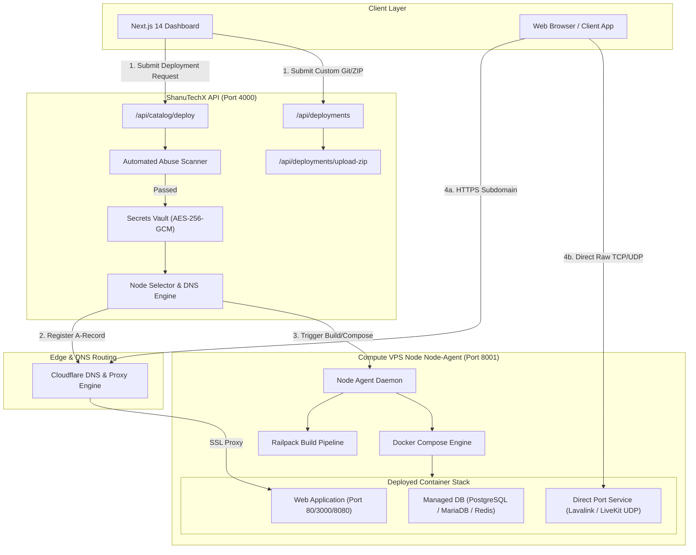
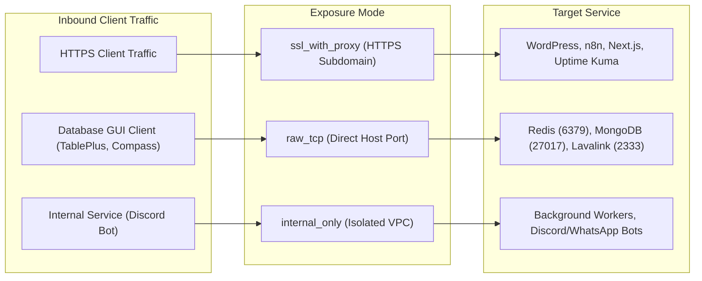
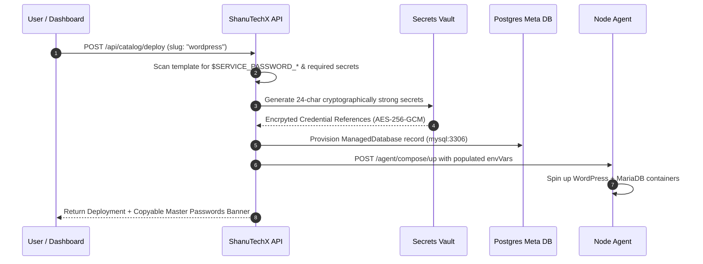
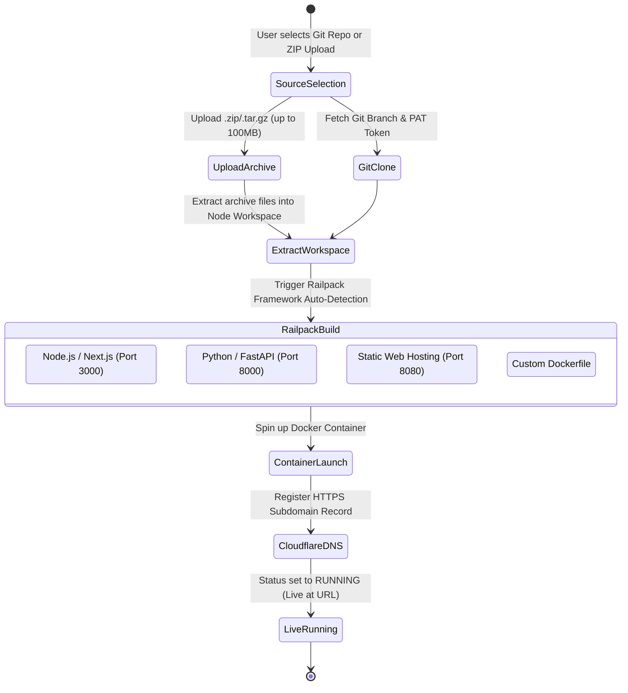

# ShanuTechX Deployment Architecture & Network Exposure Guide

> [!NOTE]
> This document visualizes the complete end-to-end deployment lifecycle, network routing topology, database auto-wiring, secret vault encryption, and compute node orchestration in ShanuTechX.

---

## 1. High-Level Architecture Overview

---

## 2. Network Exposure Modes & Traffic Routing

ShanuTechX enforces **system-recommended exposure modes** based on the workload type:

### Exposure Mode Topology Matrix

| Exposure Mode | Public Domain URL | SSL Certificate | Exposed Ports | Target Workloads |
| :--- | :--- | :--- | :--- | :--- |
| **`ssl_with_proxy`** *(Default)* | `https://<subdomain>.app.shanutechx.com` | Automated Cloudflare SSL | **None (Proxied)** | Web Apps, Storefronts, CMS (WordPress, n8n, Next.js, FastAPI, Grafana) |
| **`raw_tcp`** | `None` *(Direct Node IP)* | Client Handled / Direct TLS | **Host Port (`IP:port`)** | Databases & Media Servers (Redis, MongoDB, Lavalink, LiveKit UDP) |
| **`internal_only`** | `None` *(VPC Internal DNS)* | None | **Internal Docker Network** | Background Daemons, Discord Bots, WhatsApp Gateways, Internal APIs |

---

## 3. Database Auto-Wiring & Password Generation

When deploying 1-click catalog templates (WordPress, n8n, Redis, MongoDB, LiveKit, etc.), ShanuTechX automatically handles database setup:

### Automated Master Passwords Generated per Template

> [!TIP]
> Customers can customize passwords during setup or rely on auto-generated cryptographically secure passwords. All generated secrets are presented in a copyable banner immediately upon creation.

* **WordPress:** `MYSQL_ROOT_PASSWORD`, `WORDPRESS_DB_PASSWORD`
* **n8n:** `DB_POSTGRESDB_PASSWORD`
* **Redis:** `REDIS_PASSWORD`
* **MongoDB:** `MONGO_INITDB_ROOT_PASSWORD`
* **Supabase Lite:** `POSTGRES_PASSWORD`
* **LiveKit:** `LIVEKIT_API_KEY`, `LIVEKIT_API_SECRET`
* **Lavalink:** `LAVALINK_PASSWORD`
* **Hermes Agent:** `HERMES_SECRET_KEY`

---

## 4. Custom Code & ZIP Archive Deployment Lifecycle

---

## 5. Security Guardrails & Operational Controls

> [!IMPORTANT]
> **Enforced Platform Security Rules:**
> 1. **DEV Superuser Gating:** Non-dev users (`customer`, `support`, `admin`) are strictly locked to system-recommended exposure modes (`ssl_with_proxy` for Web Apps; `raw_tcp` for Databases). Only users with `role: 'dev'` can override exposure modes.
> 2. **Abuse Protection:** All deployment inputs (start commands, repo URLs, environment variables) pass through the automated `scanTextForAbuse` filter before execution.
> 3. **Encrypted Vault Storage:** All sensitive environment variables and database passwords are encrypted at rest using AES-256-GCM ([`secretsVault.ts`](file:///c:/Users/tiros/OneDrive/Desktop/shanutechx/apps/api/src/lib/secretsVault.ts)).
