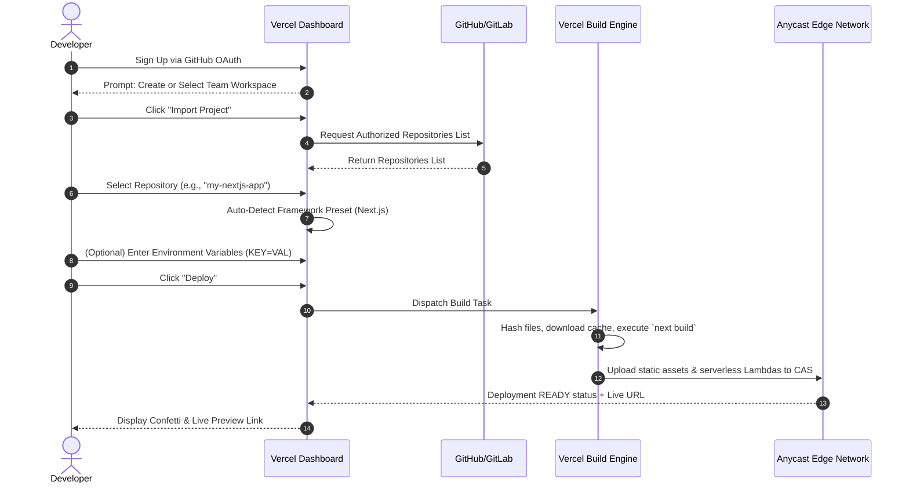

# Vercel Platform Architecture, Product Design & Infrastructure Analysis Report
> **Document Purpose**: Definitive technical reference and product design specification analyzing Vercel's platform ecosystem, UI/UX design language, deployment engine, and architecture, with actionable specifications for constructing a low-cost, developer-centric cloud hosting platform.

---

## 1. Platform Overview

### What Vercel Is
Vercel is an enterprise-grade cloud platform for frontend frameworks and static sites, built to integrate seamlessly with headless content, databases, and microservices. Founded originally as **Zeit** (creators of `now`), Vercel pioneered zero-configuration serverless web deployments and created **Next.js**, the industry-standard React framework.

Vercel functions as a **Frontend Cloud Platform**: an integrated environment combining global edge routing, automated CI/CD deployment pipelines, serverless and edge compute infrastructure, web analytics, storage primitives, and security controls tailored for modern web applications.

### Problems Vercel Solves
1. **Infrastructure Complexity Friction**: Eliminates manual provisioning of cloud servers, Nginx reverse proxies, SSL certificates, build runners, and CDN invalidation rules.
2. **Slow Feedback Loops**: Replaces manual staging environments with automatic **Preview Deployments** generated for every git commit and pull request.
3. **Frontend/Backend Friction**: Unifies frontend static asset serving with backend serverless API routes under a single repository, domain, and deployment lifecycle.
4. **Global Latency & Performance Degradation**: Automatically caches static assets and executes edge compute code close to users across a global Anycast network.
5. **Configuration Fatigue**: Replaces hundreds of lines of AWS/Terraform configurations with zero-config framework auto-detection.

### Target Users & Customer Segments
- **Individual Developers & Hobbyists**: Building personal projects, portfolios, and side projects with instant git-push deployments.
- **Startups & High-Growth Scale-ups**: Leveraging fast iteration cycles, preview URLs, and serverless scalability without dedicated DevOps teams.
- **Enterprise Engineering Teams**: Requiring SSO/SAML, role-based access control (RBAC), Web Application Firewalls (WAF), multi-zone resiliency, custom SLA guarantees, and SOC2/ISO compliance.
- **E-Commerce & Digital Agencies**: Utilizing high-performance Headless Commerce setups (Next.js + Shopify/BigCommerce/Contentful) with dynamic rendering.

### Main Use Cases
- **Full-Stack Web Applications**: Next.js, Remix, SvelteKit, Nuxt, Astro, and React Router applications combining SSR, SSG, and API endpoints.
- **Static Websites & Documentation**: Hugo, Jekyll, VitePress, Docusaurus, and Hexo blogs and documentations.
- **Microfrontends & Multi-Zone Applications**: Architectures where multiple independent repositories/deployments are routed under a unified primary domain.
- **AI-Powered Applications**: Real-time streaming chat interfaces and LLM agents using Vercel AI SDK and Vercel AI Gateway.

### Vercel vs Traditional Hosting & Cloud Providers

| Platform | Architectural Model | Deployment Paradigm | Configuration Complexity | Primary Target |
| :--- | :--- | :--- | :--- | :--- |
| **Vercel** | Serverless & Edge-First Cloud | Git Push / CLI Asset Upload | Zero-Config / Framework Presets | Frontend & Full-Stack Web |
| **Traditional VPS (cPanel/LAMP)** | Monolithic Persistent Server | FTP / Manual SSH Deployment | Manual Nginx/Apache/SSL Config | Monolithic PHP/MySQL Apps |
| **AWS (EC2 / S3 + CloudFront)** | Raw Infrastructure (IaaS) | Pipeline Scripting / Terraform | High (IAM, VPC, S3, CloudFront) | General Enterprise Infrastructure |
| **Netlify** | Jamstack / Edge Cloud | Git Push / Drag-and-Drop | Low (build settings / `netlify.toml`) | Jamstack & Static Sites |
| **Cloudflare Pages/Workers** | Edge Network Compute | Git Push / Wrangler CLI | Low-Medium (Wrangler bindings) | Edge-first workers & static sites |
| **Heroku** | Container PaaS (Dynos) | Git Push / Heroku CLI | Low (`Procfile`) | Long-running backend services |
| **Railway / Render** | Modern Container PaaS | Git Push / Dockerfile | Low (`railway.json` / `render.yaml`) | Web apps, workers, databases |
| **DigitalOcean (App Platform)** | Developer Cloud / PaaS | Git Push / Container Images | Low-Medium | Apps, databases, Kubernetes |

### Key Platform Differentiators
- **Creators of Next.js**: Unmatched deep integration with React Server Components (RSC), App Router, Incremental Static Regeneration (ISR), and Next.js optimizations.
- **Preview Deployments & Vercel Toolbar**: Live, visual feedback toolbar attached directly to preview URLs, enabling comments, visual edits, and feature flag toggles for non-technical team members.
- **Fluid Compute & Edge/Serverless Convergence**: Proprietary IPC streaming infrastructure enabling low-latency serverless function invocation with response streaming.
- **Instant Global Deployment (CAS)**: Content-addressed storage (CAS) ensures only modified files are uploaded, making deployments take seconds rather than minutes.

### Vercel's Product Ecosystem & Developer Philosophy
- **Ecosystem**: Next.js, Turborepo, v0.dev (AI UI generation), Vercel AI SDK, Geist Design System, SWR, `@vercel/nft`, `@vercel/blob`, `@vercel/edge-config`, `@vercel/kv`, `@vercel/postgres`.
- **Developer Experience (DX) Philosophy**: *"Make the right way the easy way."* Instant feedback, zero boilerplate, sensible defaults, git-driven workflow, and minimal visual noise.

---

## 2. Complete Feature Breakdown

```
                    +-------------------------------------------------------+
                    |                  VERCEL FEATURE MAP                   |
                    +-------------------------------------------------------+
                                                |
    +-------------------+-----------------------+-----------------------+-------------------+
    |                   |                       |                       |                   |
    v                   v                       v                       v                   v
+-------+           +-------+               +-------+               +-------+           +-------+
|  GIT  |           | COMPUTE|              |NETWORK|               |STORAGE|           | OBS.  |
+-------+           +-------+               +-------+               +-------+           +-------+
| Repos |           |Node.js|               |  CDN  |               |  Blob |           | Logs  |
|PR Rev |           |Python |               | Edge  |               |  KV   |           |SpeedI |
|Hooks  |           |Rust   |               | WAF   |               |Postgres|          |WebAna |
|Builds |           |Go/Ruby|               |DNS/SSL|               |EdgeConf|          |Traces |
+-------+           +-------+               +-------+               +-------+           +-------+
```

### Core Platform Features

#### 1. Projects & Workspaces
- **Purpose**: Logical container for an application's code, deployments, domains, and settings.
- **Interaction**: Managed via Vercel Dashboard or CLI (`vercel project`).
- **Technical Concepts**: Maps 1:1 or N:1 (monorepos) with Git repositories. Stores framework presets, build scripts, root directory overrides, and environment variable trees.
- **Status**: [Officially Documented]

#### 2. Git Integration & Automated CI/CD
- **Purpose**: Connects GitHub, GitLab, or Bitbucket repositories for automated build triggers.
- **Workflow**: Pushing to `main` triggers a Production Deployment; pushing to feature branches creates a Preview Deployment; PR comments receive preview links.
- **Technical Concepts**: Webhook event handlers parse commit hashes, author metadata, and branch titles to initiate build pipelines.
- **Status**: [Officially Documented]

#### 3. Preview Deployments
- **Purpose**: Creates an isolated, immutable environment for every commit/PR.
- **Features**: Unique generated URLs (`https://<project>-git-<branch>-<team>.vercel.app`), Vercel Toolbar integration, password protection, and comment threads.
- **Technical Concepts**: Immutable build artifacts bound to unique routing identifiers.
- **Status**: [Officially Documented]

#### 4. Production Deployments & Instant Rollbacks
- **Purpose**: Serves live production traffic on the primary custom domain.
- **Workflow**: Merging to `main` promotes code to production; clicking "Promote to Production" on a past deployment executes instant DNS pointer swap (< 300ms) without rebuilding.
- **Technical Concepts**: Atomic routing pointer update across global Anycast edge nodes.
- **Status**: [Officially Documented]

#### 5. Custom Domains & Automated Managed DNS
- **Purpose**: Binds custom apex domains (`example.com`) and subdomains (`app.example.com`).
- **Features**: Automatic Let's Encrypt TLS/SSL certificate issuance, DNS record hosting, wildcards, CNAME flattening, and automatic HTTP -> HTTPS redirects.
- **Technical Concepts**: Integrates with Cloudflare/Vercel DNS nameservers; automated ACME protocol validation.
- **Status**: [Officially Documented]

#### 6. Environment Variables System
- **Purpose**: Securely injects configuration secrets into build and runtime environments.
- **Features**: Scoped by target environment (Development, Preview, Production), branch-specific overrides, encrypted values, systemic decryption key management, and `vercel env pull`.
- **Technical Concepts**: Environment values encrypted with AES-256; injected into Lambda function execution contexts and build containers.
- **Status**: [Officially Documented]

#### 7. Serverless Functions (`@vercel/node`, `@vercel/python`, `@vercel/ruby`, `@vercel/go`)
- **Purpose**: Executes backend code on demand without managing persistent servers.
- **Technical Concepts**: Packaged into AWS Lambda zip artifacts using `@vercel/nft` (Node File Trace) for tree-shaking; supports HTTP response streaming, maximum execution durations (up to 900s on Enterprise), and Fluid Compute IPC protocol.
- **Status**: [Officially Documented]

#### 8. Edge Functions & Edge Middleware
- **Purpose**: Executes lightweight JavaScript/TypeScript code at global Anycast edge locations before hitting cache or origin serverless functions.
- **Technical Concepts**: Powered by V8 isolation runtimes (Edge Runtime); zero cold starts; ideal for geo-location routing, auth verification, AB testing, and header manipulation.
- **Status**: [Officially Documented]

#### 9. Vercel Storage Suite (Blob, KV, Postgres, Edge Config)
- **Vercel Blob**: S3-compatible object storage optimized for public and private uploads (`@vercel/blob`).
- **Vercel KV**: Low-latency, Redis-compatible key-value store powered by Upstash (`@vercel/kv`).
- **Vercel Postgres**: Serverless relational SQL database powered by Neon (`@vercel/postgres`).
- **Vercel Edge Config**: Global ultra-low-latency (< 15ms read) read-heavy configuration store replicated across edge points of presence (`@vercel/edge-config`).
- **Status**: [Officially Documented]

#### 10. Web Application Firewall (WAF) & Security Controls
- **Purpose**: Protects applications against malicious traffic, bot attacks, and DDoS.
- **Features**: Custom WAF rules (IP blocking, country blocking, rate limiting, JA3 fingerprinting), Deployment Protection (SAML/OAuth/password login for previews), and Attack Challenge Mode.
- **Status**: [Officially Documented]

#### 11. Monitoring, Observability & Speed Insights
- **Runtime Logs**: Real-time log streaming (`vercel logs`), filtering by status code, level, duration, and route.
- **Web Analytics**: Privacy-focused real-time visitor traffic analytics without tracking cookies.
- **Speed Insights**: Automated Real User Monitoring (RUM) tracking Core Web Vitals (LCP, FID/INP, CLS) per page path and device type.
- **Status**: [Officially Documented]

#### 12. Vercel Feature Flags (`vercel flags`)
- **Purpose**: Manages feature flag declarations, user segment splits, and percentage rollouts natively integrated with Next.js App Router and Edge Middleware.
- **Status**: [Officially Documented]

#### 13. Vercel Sandbox & Container Registry (VCR)
- **Purpose**: Managed OCI container execution sandbox and container registry (`vercel vcr`) for non-standard runtime workloads and custom Linux environments.
- **Status**: [Observed from CLI & Docs]

---

## 3. Vercel Dashboard UI Analysis

### Overall UI Architecture & Navigation Structure
The Vercel Dashboard ([`vercel.com/dashboard`](https://vercel.com/dashboard)) is designed around a **Scope-First, Project-Centric Hierarchy**.

```
+-----------------------------------------------------------------------------------+
|  [Vercel Logo]  [Scope Switcher: Personal / Team v]   [Search / ]   [Feedback] [Avatar]
+-----------------------------------------------------------------------------------+
|  Overview  |  Integrations  |  Storage  |  Usage  |  Monitoring  |  Settings      |
+-----------------------------------------------------------------------------------+
|                                                                                   |
|  [ Search Projects... ]      [ Filter by Framework v ]     [ Add New... v ]        |
|                                                                                   |
|  +---------------------------+  +---------------------------+  +----------------+  |
|  | Project Card 1            |  | Project Card 2            |  | Project Card 3 |  |
|  | - Next.js (Ready)         |  | - Remix (Building)        |  | - Vite (Ready) |  |
|  | - main -> app.vercel.app  |  | - dev -> app-dev.v.app    |  | - main         |  |
|  +---------------------------+  +---------------------------+  +----------------+  |
|                                                                                   |
+-----------------------------------------------------------------------------------+
```

### Breakdown of Primary Screens

#### 1. Scope Level (Team/Personal Account View)
- **Top Navigation Bar**: Scope Switcher dropdown (select personal account or enterprise teams), Search input (activated via `Cmd + K` or `/`), Notifications Bell, and User Profile menu.
- **Primary Scope Tabs**:
  - `Overview`: Grid/list of all active projects with quick status indicators, production domain links, and framework icons.
  - `Integrations`: Installed database, logging, and security integrations.
  - `Storage`: Centralized view of Vercel Blob stores, Postgres databases, KV stores, and Edge Configs.
  - `Usage`: Real-time bandwidth, execution units, build time, and storage usage metrics against plan quotas.
  - `Monitoring`: Enterprise log drain and monitoring configurations.
  - `Settings`: Team members, billing subscriptions, SAML SSO, and audit logs.

#### 2. Project Level View (`/scope/project-name`)
When clicking a project, the top navigation context updates to project-specific tabs:
- **Project Navigation Tabs**:
  - `Overview`: Recent production deployment preview screenshot, deployment status pill, instant domain link, recent git commit message, and quick performance scores.
  - `Deployments`: Chronological table of all past preview and production deployments with filtering by branch, status (Ready, Error, Building, Canceled), and author.
  - `Analytics`: Web traffic metrics (top pages, countries, referrers, operating systems).
  - `Speed Insights`: Real-user Web Vitals scores categorized into Good, Needs Improvement, and Poor.
  - `Logs`: Real-time streaming log console with live search, log level filters (Error, Warning, Info), and request trace detail drawers.
  - `Storage`: Storage instances bound to this project.
  - `Settings`: Comprehensive project settings panel (General, Environment Variables, Domains, Git, Functions, Security, Deployment Protection, Integrations).

#### 3. Deployment Detail View (`/scope/project-name/deployment-id`)
- **Header**: Deployment URL link, branch badge, commit SHA link, duration, and status indicator.
- **Body**: 
  - *Preview Screen / Canvas*: Embedded iframe preview of the deployment.
  - *Source & Build Details*: Git commit metadata, author, framework version.
  - *Build Logs Accordion*: Real-time terminal output stream with line numbers and search filter.
  - *Routes & Functions Summary*: Table listing generated static routes, serverless functions, edge middleware, and asset sizes.

---

## 4. UI/UX Design System (Vercel Geist)

Vercel's visual identity relies on **Geist**, a high-precision, developer-first design system characterized by monochrome elegance, high contrast, strict typographic hierarchy, and subtle micro-interactions.

```
+-----------------------------------------------------------------------------------+
|                              GEIST DESIGN TOKENS                                 |
+-----------------------------------------------------------------------------------+
|  COLORS:      #000000 (Black)  |  #FFFFFF (White)  |  #111111 (Dark Gray Surface) |
|               #888888 (Muted Gray Text)            |  #0070F3 (Vercel Electric Blue)|
|  TYPOGRAPHY:  Geist Sans (UI & Prose)               |  Geist Mono (Code & Logs)    |
|  BORDERS:     1px solid #333333 (Subtle Muted)      |  Radius: 6px (Standard Pill) |
+-----------------------------------------------------------------------------------+
```

### Visual & Component Specifications

#### 1. Color Palette & Dark/Light Mode
- **Dark Mode (Default)**: Pitch-black background (`#000000`), dark gray container cards (`#111111`), subtle 1px gray borders (`#333333`), crisp white primary text (`#FFFFFF`), muted gray secondary text (`#888888`).
- **Accent Colors**: 
  - *Vercel Blue (`#0070F3`)*: Primary actions, links, active state indicators.
  - *Success Green (`#50E3C2` / `#10B981`)*: Deployment Ready status pills.
  - *Error Red (`#FF0000` / `#EF4444`)*: Failed builds, error logs, destructive buttons.
  - *Warning Yellow (`#F5A623`)*: Building state spinners, rate limit warnings.

#### 2. Typography Hierarchy
- **Font Families**:
  - `Geist Sans`: Custom geometric/neo-grotesque sans-serif font designed for readability on high-DPI displays.
  - `Geist Mono`: High-precision monospace font used for code blocks, commit hashes, deployment IDs, and log streams.
- **Type Scale**:
  - `Page Title (H1)`: `24px` / `30px` line-height, Semi-Bold (`600`).
  - `Section Header (H2)`: `18px` / `24px` line-height, Medium (`500`).
  - `Card Title (H3)`: `14px` / `20px` line-height, Medium (`500`).
  - `Body Text`: `14px`, Regular (`400`).
  - `Subtext / Captions`: `12px`, Muted Gray (`#888888`).
  - `Code / Terminal`: `13px` Geist Mono.

#### 3. Core Component Library

| Component | Visual Styling | Hover / Active State |
| :--- | :--- | :--- |
| **Primary Button** | Solid White background, Black text (`#000`), 6px border radius, 14px Medium. | Opacity transitions to 90% white on hover; subtle scale transform. |
| **Secondary Button** | Transparent background, 1px Gray border (`#333`), White text. | Background changes to `#222` on hover. |
| **Destructive Button** | Dark Red tint background or Red border, White/Red text. | Solid Red background (`#FF0000`) on hover. |
| **Cards & Containers** | Dark Gray (`#111`), 1px subtle border (`#333`), 8px radius. | Border brightens to `#666` on hover; smooth transition. |
| **Status Pills** | 12px pill shape, subtle background tint (e.g. muted green), dot indicator. | Glowing dot animation for `Building` state. |
| **Inputs & Selects** | Black background, 1px border (`#333`), 6px radius, placeholder in muted gray. | Border turns Vercel Blue (`#0070F3`) on focus; no browser outline. |
| **Modals / Dialogs** | Centered overlay, blurred dark backdrop (`backdrop-filter: blur(8px)`), 12px radius. | Smooth fade-in and scale-up animation. |

### Why This Design Works for Developers
1. **Low Cognitive Load**: High-contrast, clutter-free layouts reduce distraction when inspecting complex build logs and configurations.
2. **Information Density Balance**: Clear grid boundaries allow dense metrics (DNS records, environment variables) to remain readable.
3. **Monospace Alignment**: Using Geist Mono for IDs, commit SHAs, and URLs creates a natural extension of a developer's code editor (VS Code/Neovim).

---

## 5. User Experience Analysis

### Complete User Journey Flowcharts

#### 1. New User Onboarding & First Deployment



#### 2. Continuous Developer Workflow

```mermaid
flowchart TD
    A[Developer Pushes Code to Git Branch] --> B{Branch Type?}
    B -->|Feature Branch / PR| C[Trigger Preview Deployment]
    B -->|Main / Master Branch| D[Trigger Production Deployment]
    
    C --> E[Build Engine Compiles Isolated Preview]
    E --> F[Generate Immutable URL: project-git-feat.vercel.app]
    F --> G[Attach Vercel Toolbar & Post Comment on PR]
    G --> H[Team Reviews & Leaves Visual Comments]
    H --> I[PR Merged into Main]
    I --> D
    
    D --> J[Build Engine Compiles Production Bundle]
    J --> K[Atomic DNS Swap to Custom Domain: example.com]
    K --> L[Real-Time Analytics & Speed Insights Tracking]
    
    L -->|Bug Detected| M[Click "Promote to Production" on Previous Deployment]
    M --> N[Instant 300ms Rollback to Known Good State]
```

---

## 6. Detailed Information Architecture

```text
Vercel Platform
├── Dashboard (Scope Switcher)
│   ├── Personal Account Scope (~/username)
│   └── Team Scope (~/team-name)
│       ├── Overview (Projects Grid / List View)
│       ├── Integrations (Marketplace / Installed Integrations)
│       ├── Storage (Database Hub & File Stores)
│       │   ├── Vercel Blob Stores
│       │   ├── Vercel Postgres Databases
│       │   ├── Vercel KV Databases
│       │   └── Edge Config Instances
│       ├── Usage (Metrics & Quota Consumption)
│       │   ├── Fast Data Transfer (Bandwidth)
│       │   ├── Serverless Function Execution Units
│       │   ├── Edge Function Invocations
│       │   ├── Build Image Hours
│       │   └── Storage Capacity & Operations
│       ├── Monitoring (Enterprise Log Drains & Traces)
│       └── Settings (Team Level Settings)
│           ├── General (Team Name, Avatar, ID)
│           ├── Members & Roles (Owner, Member, Developer, Billing)
│           ├── Billing & Plans (Subscription, Payment Methods, Invoices)
│           ├── Single Sign-On (SAML / OIDC Enforcement)
│           ├── Security & Audit Logs
│           └── Environment Variable Templates
│
└── Project Level Workspace (~/team-name/project-name)
    ├── Overview (Live Production Card, Recent Deployments, Quick Metrics)
    ├── Deployments (Chronological Deployments Ledger)
    │   └── Deployment Details (~/project-name/deployment-id)
    │       ├── Overview Canvas & Preview Iframe
    │       ├── Build Logs Terminal Stream
    │       ├── Source & Git Commit Info
    │       ├── Functions & Routes Inventory
    │       └── Instant Rollback / Promotion Trigger
    ├── Analytics (Web Traffic & Visitor Metrics)
    ├── Speed Insights (Core Web Vitals RUM Scores)
    ├── Logs (Real-time Streaming Log Console & Trace Viewer)
    ├── Storage (Project-Bound Storage Resources)
    └── Settings (Project Specific Configuration)
        ├── General (Framework Preset, Build & Dev Commands, Root Directory)
        ├── Environment Variables (Development, Preview, Production Keys)
        ├── Domains (Custom Domain Names, DNS Records, SSL Certs)
        ├── Git (Connected Repository, Production Branch, Deploy Hooks)
        ├── Functions (Memory Size, Region, Timeout Overrides)
        ├── Security & Deployment Protection (Password, SSO, WAF Rules)
        ├── Integrations (Project-Bound Third-Party Services)
        └── Feature Flags (Flag Definitions & Percentage Splits)
```

---

## 7. Deep Dive: Deployment Lifecycle

```
[ Git Push / CLI ] 
        |
        v
+-----------------------------------------------------------------------------------+
| 1. INGESTION & CAS DEDUPLICATION                                                 |
|    - Reads project files, calculates SHA-1 checksums per file.                     |
|    - Sends SHA map to Vercel API (/v13/deployments).                              |
|    - Platform compares SHA list against global CAS (Content Addressed Storage).  |
|    - CLI uploads ONLY missing file blobs via parallel streams (async-sema).       |
+-----------------------------------------------------------------------------------+
        |
        v
+-----------------------------------------------------------------------------------+
| 2. BUILD ENGINE ORCHESTRATION                                                     |
|    - Spawns isolated Linux container pre-loaded with Node/Python/Rust.            |
|    - Restores dependency cache from previous build (`prepareCache`).               |
|    - Executes framework build command (e.g. `next build`, `vite build`).          |
|    - `@vercel/nft` static analysis traces AST dependencies for serverless functions.|
|    - Generates standardized `.vercel/output/` directory (Build Output API v3).    |
+-----------------------------------------------------------------------------------+
        |
        v
+-----------------------------------------------------------------------------------+
| 3. ATOMIC ROUTE ASSEMBLY & EDGE PROPAGATION                                       |
|    - Uploads generated static HTML/JS/CSS to CDN edge nodes.                       |
|    - Packages serverless functions into AWS Lambda artifacts with Fluid IPC.       |
|    - Deploys V8 Edge Middleware to Anycast edge nodes worldwide.                  |
|    - Atomically updates routing table pointers across edge nodes (< 300ms).        |
+-----------------------------------------------------------------------------------+
        |
        v
[ Live Deployment URL Ready: project-hash.vercel.app ]
```

---

## 8. Architecture & Technical Concepts

### Publicly Documented Architecture & Technical Inferences

#### 1. Content-Addressed Storage (CAS)
- **Documented**: Deployments use file SHA-1 digests to identify files uniquely.
- **Inference**: By hashing files on the client CLI before uploading, Vercel never uploads duplicate files across builds or projects, drastically saving bandwidth and build preparation time.

#### 2. Fluid Compute & Serverless Response Streaming
- **Documented**: Runtimes communicate over a local Unix domain socket (`VERCEL_IPC_PATH`) using null-byte (`\0`) terminated JSON frames (`server-started`, `log`, `end`).
- **Technical Mechanism**: Eliminates traditional HTTP proxy overhead between origin routers and serverless workers. Enables chunked transfer encoding (`Transfer-Encoding: chunked`) directly from serverless function streams to clients.

#### 3. Build Output API (v3 Specification)
- **Documented**: Frameworks compile output into `.vercel/output/`:
  - `.vercel/output/static/`: Pure static files served directly by global CDN edge.
  - `.vercel/output/functions/`: Serverless functions packaged as `.func` directories containing `package.json`, code, and `.vc-config.json`.
  - `.vercel/output/config.json`: Routing rules, headers, overrides, and rewrites.

#### 4. Global Anycast Edge Network & Caching
- **Documented**: Vercel utilizes an Anycast network paired with Tier-1 CDN providers (Cloudflare, AWS CloudFront) to route traffic to the geographically nearest edge pop.
- **Caching Mechanism**: Edge nodes respect standard `Cache-Control` headers along with Vercel extensions (`s-maxage`, `stale-while-revalidate`). When ISR (Incremental Static Regeneration) triggers, edge nodes serve stale pages instantly while firing a background regeneration job to update the CDN cache atomically.

---

## 9. Developer Experience (DX) Analysis

### Friction Reduction Matrix

| Developer Friction Point | Traditional Cloud / Custom Setup | Vercel Solution |
| :--- | :--- | :--- |
| **Setting Up Staging Environments** | Manual provisioning of QA servers, database seeding, Nginx config. | **Zero Effort**: Automatic Preview Deployment per Git branch/PR with instant URL. |
| **SSL Certificate Management** | Renewing Let's Encrypt certs, certbot crons, Nginx reloading. | **Zero Effort**: Automatic managed TLS/SSL certificate generation & renewal. |
| **Build Optimization & Bundling** | Writing complex Webpack/Rollup scripts to bundle backend APIs. | **Zero Effort**: `@vercel/nft` automatically tree-shakes unused `node_modules` code. |
| **Environment Variable Sync** | Copying `.env` files across team Slack channels, SSHing to servers. | **Unified Tooling**: `vercel env pull` syncs encrypted cloud secrets to local `.env.local`. |
| **Rollback Under Production Outage** | Re-running failed CI/CD pipelines or manually git-reverting commits. | **Sub-Second Rollback**: One-click instant DNS pointer swap to previous successful build. |

---

## 10. CLI & Developer Tools Architecture

```
                  +----------------------------------------------+
                  |               DEVELOPER INTERFACE            |
                  +----------------------------------------------+
                                   |              |
                    +--------------+              +--------------+
                    |                                            |
                    v                                            v
     +------------------------------+             +------------------------------+
     |   Vercel Web Dashboard       |             |     Vercel CLI (vercel)      |
     +--------------+---------------+             +--------------+---------------+
                    |                                            |
                    +--------------+--------------+--------------+
                                   |
                                   v
                  +----------------------------------------------+
                  |  Vercel REST API (v13/deployments, v9/proj)  |
                  +----------------------------------------------+
                                   |
                                   v
                  +----------------------------------------------+
                  |       Vercel Cloud Infrastructure Platform   |
                  +----------------------------------------------+
```

### Essential CLI Commands & Workflows

| Command | Category | Functional Purpose |
| :--- | :--- | :--- |
| `vercel login` | Authentication | Initiates interactive OAuth/device login to store user access token. |
| `vercel link` | Project Linking | Binds current workspace directory to a Vercel Project (`.vercel/project.json`). |
| `vercel link --repo` | Monorepo Linking | Maps monorepo root subdirectories to distinct Vercel Projects (`.vercel/repo.json`). |
| `vercel dev` | Local Emulation | Runs local HTTP server emulating Vercel edge routing and function execution. |
| `vercel deploy` | Preview Build | Hashes workspace, uploads missing files, and triggers a Preview Deployment. |
| `vercel --prod` | Production Build | Deploys directly to live production domain. |
| `vercel env pull` | Env Management | Downloads cloud environment variables into local `.env.local` file. |
| `vercel logs <url>` | Observability | Streams real-time runtime execution logs from production/preview functions. |
| `vercel rollback` | Disaster Recovery | Promotes previous deployment to production instantly without rebuilding. |
| `vercel mcp` | AI Integration | Launches Model Context Protocol (MCP) server for local AI assistant interaction. |

---

## 11. APIs & Integrations Ecosystem

Vercel provides a robust **REST API** along with webhooks and direct integrations to extend platform functionality.

- **Vercel REST API**: Exposes endpoints for managing projects, deployments, domains, DNS records, environment variables, teams, tokens, and firewall rules.
- **Git Provider Integrations**: Native apps for GitHub, GitLab, and Bitbucket that handle OAuth authorization, commit status checks, deployment status comments, and repository webhooks.
- **Marketplace & Integrations**: One-click connections to database providers (Neon, PlanetScale, Supabase, Redis/Upstash), logging services (Datadog, Logtail, Axiom), security scanners (Snyk), and headless CMS platforms (Sanity, Contentful, Strapi).

---

## 12. Pricing & Usage Model Analysis

Vercel operates a **Freemium + Usage-Based Billing Model** structured into three primary tiers:

### Tier Breakdown
1. **Hobby (Free)**: Designed for personal projects and non-commercial side apps. Includes automatic HTTPS, preview deployments, 100GB fast data transfer, limited build execution time, and single-user access.
2. **Pro ($20 / month per seat)**: Designed for professional developers and small teams. Unlocks team collaboration, higher build concurrency, 1TB fast data transfer, custom password protection, advanced analytics, and split environment variables.
3. **Enterprise (Custom Quote)**: Designed for enterprise organizations. Unlocks 99.99% uptime SLAs, dedicated support, SAML/SSO enforcement, custom WAF rules, isolated build infrastructure, audit logs, and SOC2 compliance.

### Metered Usage Dimensions
- **Fast Data Transfer (Bandwidth)**: Measured in GB transferred from edge nodes to clients.
- **Serverless Function Execution**: Measured in `GB-Hours` (memory allocated × execution duration).
- **Edge Function Invocations**: Measured per million invocations.
- **Build Execution Time**: Measured in build container compute minutes.
- **Vercel Storage Operations**: Blob storage capacity/bandwidth; KV read/write units; Postgres storage/compute hours.

---

## 13. Security Infrastructure

- **Authentication & Role-Based Access Control (RBAC)**: Team permissions scoped to `Owner`, `Member`, `Developer`, and `Billing`. Enterprise SSO enforces Okta/Azure AD SAML authentication.
- **Deployment Protection**: Previews can be secured using HTTP Basic Auth, Vercel OAuth login, or Custom Password protection to prevent unauthorized public access to pre-release code.
- **Isolated Function Execution**: Serverless functions run in ephemeral, single-tenant sandboxes; Edge functions run in V8 isolates preventing cross-request memory contamination.
- **Encrypted Secret Storage**: Environment variables encrypted at rest with AES-256-GCM; secrets decrypted only inside isolated build containers and function execution environments.

---

## 14. Performance Engineering

1. **Edge Asset Caching**: Static assets served from global Anycast edge nodes with HTTP/2 and HTTP/3 support.
2. **Automatic Image Optimization**: Dynamically resizes, compresses, and converts images to modern formats (`.webp`, `.avif`) on demand (`next/image`).
3. **Smart Code Splitting & Tree Shaking**: Static analysis bundles only required dependencies per page/function route, minimizing payload sizes.
4. **Stale-While-Revalidate & ISR**: Edge nodes serve cached static content instantaneously while asynchronously revalidating expired paths in the background.

---

## 15. Developer-Focused UX Patterns for Cloud Platforms

### Reusable UX Design Patterns

#### 1. Instant Visual Feedback (Confetti & Live Progress)
Upon deployment submission, the UI displays real-time progress bars, terminal logs, and a confetti animation when the build succeeds.
*Application to Other Platforms*: Elevates developer satisfaction during repetitive build wait times.

#### 2. Direct Source-to-Log Traceability
Every log line and error trace features clickable links jumping directly to the corresponding Git commit SHA and source file line number.
*Application to Other Platforms*: Drastically reduces mean time to resolution (MTTR) during outages.

#### 3. Zero-Config Presets with Explicit Overrides
Auto-detects build parameters while exposing collapsible override inputs for custom build scripts and output directories.
*Application to Other Platforms*: Eliminates barrier to entry without trapping advanced users in restrictive abstractions.

#### 4. Contextual Copy-Paste CLI Commands
When a deployment fails or requires configuration, the UI displays ready-to-execute terminal snippets (e.g. `vercel env pull`) with copy buttons.
*Application to Other Platforms*: Bridges web dashboard interactions seamlessly with local terminal developer workflows.

---

## 16. Low-Cost Vercel-Inspired Platform Specification (ShanuTechX)

To build a low-cost, student-focused hosting platform inspired by Vercel, features should be prioritized into four progressive engineering phases:

### Feature Implementation Matrix

| Feature | Phase | Priority | Infrastructure / Tech Requirement | Complexity | Dev Effort | Value |
| :--- | :--- | :--- | :--- | :--- | :--- | :--- |
| **Static Site Hosting** | MVP | P0 | Nginx / Traefik, Local Storage, Git Webhooks | Low | 2 Weeks | High |
| **Git Integration (GitHub)** | MVP | P0 | GitHub OAuth App, Webhook Handlers | Medium | 2 Weeks | Critical |
| **Containerized Build System** | MVP | P0 | Docker Engine API, Isolated Build Workers | High | 4 Weeks | Critical |
| **Automatic Managed SSL** | MVP | P0 | Caddy / Let's Encrypt ACME API | Medium | 1 Week | Critical |
| **Custom Domains System** | MVP | P0 | Cloudflare DNS API / CNAME Verification | Medium | 1 Week | High |
| **Node.js Serverless Functions**| V2 | P1 | Docker Containers / OpenFaaS / K3s | High | 4 Weeks | High |
| **Preview Environments** | V2 | P1 | Dynamic Subdomain Router, Isolated DBs | Medium | 2 Weeks | High |
| **Real-Time Build & App Logs** | V2 | P1 | Redis Pub/Sub, WebSockets, xterm.js | Medium | 2 Weeks | High |
| **Environment Secret Manager** | V2 | P1 | AES-256 Vault, Encrypted DB Table | Low | 1 Week | Critical |
| **One-Click App Templates** | V3 | P2 | Docker Compose Catalog, Git Cloner | Medium | 2 Weeks | High |
| **Managed Postgres/MySQL** | V3 | P2 | Docker Container Auto-Provisioner | High | 3 Weeks | High |
| **Bandwidth & Usage Metering**| V3 | P2 | Prometheus / Nginx Log Parsers | Medium | 2 Weeks | Medium |
| **Team Workspaces & RBAC** | Enterprise| P3 | Organization DB Schemas, Role Middleware | Medium | 3 Weeks | High |
| **WAF & Rate Limiting** | Enterprise| P3 | Cloudflare WAF API / Nginx Rate Limits | High | 2 Weeks | High |

---

## 17. Low-Cost Platform System Architecture

```
                                  [ USER / DEVELOPER ]
                                           |
                                  +--------+--------+
                                  |                 |
                                  v                 v
                         +-----------------+  +-------------------+
                         |  Web Dashboard  |  |  CLI Tool (stx)   |
                         |  (Next.js 14)   |  |  (Node / Go CLI)  |
                         +--------+--------+  +---------+---------+
                                  |                     |
                                  +--------+------------+
                                           |
                                           v
                               +-----------------------+
                               |  API Gateway          |
                               |  (Express / Fastify)  |
                               +-----------+-----------+
                                           |
               +---------------------------+---------------------------+
               |                           |                           |
               v                           v                           v
     +-------------------+       +-------------------+       +-------------------+
     | Auth Service      |       | Project Service   |       | Deployment Engine |
     | (Firebase/OAuth)  |       | (Prisma + Postgres|       | (Task Orchestration|
     +-------------------+       +-------------------+       +---------+---------+
                                                                       |
                                                                       v
                                                             +-------------------+
                                                             | BullMQ Queue      |
                                                             | (Redis Managed)   |
                                                             +---------+---------+
                                                                       |
                                                                       v
                                                             +-------------------+
                                                             | Build Worker Host |
                                                             | (Docker Engine)   |
                                                             +---------+---------+
                                                                       |
                                         +-----------------------------+-----------------------------+
                                         |                                                           |
                                         v                                                           v
                               +-------------------+                                       +-------------------+
                               | Object Storage    |                                       | Container Registry|
                               | (MinIO / R2)      |                                       | (Local / Harbor)  |
                               +---------+---------+                                       +---------+---------+
                                         |                                                           |
                                         +-----------------------------+-----------------------------+
                                                                       |
                                                                       v
                                                             +-------------------+
                                                             | Reverse Proxy Router|
                                                             | (Traefik/Cloudflare|
                                                             +---------+---------+
                                                                       |
                                                                       v
                                                             [ LIVE USER APP ]
```

### Component Breakdown
1. **API Gateway & Auth Service**: Central entrypoint handling Bearer tokens, OAuth callbacks, and request rate limiting.
2. **Database & Secret Vault**: PostgreSQL storing project configurations; AES-256 encrypted fields for environment variables.
3. **Queue & Build Workers**: BullMQ (Redis-backed) dispatches build jobs to isolated Worker VPS instances running Docker.
4. **Storage & Reverse Proxy**: Builds output static artifacts to S3-compatible storage (MinIO / Cloudflare R2); Traefik or Nginx dynamically routes incoming requests to storage buckets or container ports based on subdomain headers.

---

## 18. Suggested Technology Stack for Low-Cost Platform

### Technology Evaluation & Comparison

| Subsystem | Option A | Option B | Option C | Recommended Choice & Justification |
| :--- | :--- | :--- | :--- | :--- |
| **Frontend UI** | **Next.js 14 + Tailwind** | React + Vite | Vue 3 + Nuxt | **Next.js 14 + Tailwind CSS + shadcn/ui**: Unmatched developer familiarity, SSR support, fast UI component scaffolding. |
| **Backend API** | **Express (TypeScript)** | Go (Gin) | Rust (Axum) | **Express.js (TypeScript)**: Rapid development, shared types with frontend monorepo, rich ecosystem. |
| **Build Execution** | **Docker Engine API** | Kubernetes (K3s) | Nomad | **Docker Engine API on VPS**: Significantly lower memory footprint than Kubernetes; easy to isolate build steps. |
| **Reverse Proxy** | **Traefik** | Nginx | Cloudflare Workers | **Traefik or Cloudflare DNS + Nginx**: Dynamic Let's Encrypt SSL generation, automatic container discovery. |
| **Database** | **PostgreSQL + Prisma** | MySQL | MongoDB | **PostgreSQL + Prisma ORM**: ACID compliance, strong JSON column support, type-safe migrations. |
| **Queue / Workers** | **BullMQ + Redis** | RabbitMQ | NATS | **BullMQ + Redis**: Lightweight, reliable job retries, event pub/sub for live log streaming. |
| **Object Storage** | **Cloudflare R2** | AWS S3 | MinIO (Self-Hosted) | **Cloudflare R2 or Self-Hosted MinIO**: Zero egress fees with Cloudflare R2; MinIO for 100% self-hosted zero-cost setups. |

---

## 19. Strategic Comparison Matrix: Vercel vs Our Low-Cost Platform (ShanuTechX)

| Feature Dimension | Vercel Platform | Low-Cost Student Platform (ShanuTechX) | Differentiating Advantage |
| :--- | :--- | :--- | :--- |
| **Target Audience** | Enterprise & High-Growth Startups | Students, Educators, Indie Hacking | Tailored low-cost pricing, zero surprise bill shock. |
| **Pricing Model** | Usage-Based Metering (Expensive Egress) | Fixed Low-Cost Monthly Cap / Free Tier | Predictable costs for budget-conscious users. |
| **Infrastructure** | Proprietary AWS + Anycast Edge | Self-Hosted VPS Nodes + Hetzner/DigitalOcean | Significantly cheaper operational overhead. |
| **Deployment Mechanism** | Advanced Fluid Compute + Edge Isolates | Docker Containerized Apps & Static Storage | Simpler operational debugging model for students. |
| **Database Offerings** | Managed Neon / Upstash Integrations | Integrated One-Click Supabase & Docker DBs | Native self-hosted Supabase stack management. |
| **Custom Domains** | Managed Cloudflare / AWS Route 53 | Cloudflare API Automatic A-Record Provisioning | Auto-generated custom platform subdomains. |
| **Developer Experience** | Industry Benchmark (Geist Design) | Minimalist Vercel-Inspired Design System | Fast, clutter-free dashboard UI. |

---

## 20. Complete Feature Implementation Roadmap

```
+-----------------------------------------------------------------------------------+
|                           PHASED IMPLEMENTATION ROADMAP                           |
+-----------------------------------------------------------------------------------+

[ PHASE 1: CORE HOSTING & STATIC DEPLOYMENTS ]
  ├── User Auth (GitHub OAuth)
  ├── Static File Storage (MinIO / S3)
  ├── Basic Project Creation & Manual Upload
  └── Nginx / Traefik Static File Routing

[ PHASE 2: AUTOMATED GIT DEPLOYMENT ENGINE ]
  ├── GitHub Webhook Integration
  ├── Docker Build Worker Pipeline (Node, Vite, React builds)
  ├── Real-time Log Streaming via WebSockets
  └── Automatic Subdomain Assignment (app-name.platform.dev)

[ PHASE 3: CUSTOM DOMAINS & AUTOMATED SSL ]
  ├── Cloudflare DNS API Integration
  ├── Automated Let's Encrypt Certificate Issuance
  └── Custom Domain Management UI

[ PHASE 4: ENVIRONMENT SECRETS & PREVIEW ENVS ]
  ├── Encrypted Vault for KEY=VALUE Environment Variables
  ├── Preview Deployments per Feature Branch / PR
  └── Isolated Build Artifact Storage per Commit

[ PHASE 5: CONTAINERS & DATABASE PROVISIONING ]
  ├── One-Click Managed Postgres / MySQL Container Provisioning
  ├── Self-Hosted Supabase Stack Integration
  └── Docker Compose Template Catalog (15+ App Presets)

[ PHASE 6: LOGS, MONITORING & BILLING CAP ]
  ├── Real-time App Container Metrics (CPU/RAM Usage)
  ├── Fixed Monthly Usage Hard Caps (Prevents Overages)
  └── Stripe / Payment Gateway Integration
```

---

## 21. Final Summary & Key Takeaways

### Core Drivers of Vercel's Success
1. **Vertical Integration**: Creating **Next.js** gave Vercel an unmatched competitive advantage, allowing them to design platform features (ISR, Edge Middleware, Server Actions) in tandem with the framework.
2. **Git-Centric Workflow Paradigm**: Shifting deployment from manual operations to a passive side-effect of `git push` transformed industry standards.
3. **Geist Design Discipline**: Elevating developer platform UI/UX from ugly utility dashboards to sleek, high-contrast, professional tools.
4. **Immutable Preview URLs**: Revolutionized team collaboration by bringing non-technical stakeholders directly into pre-release review loops.

### Essential Features to Replicate for a Low-Cost Platform
- Automated Git-Push deployments with instant build feedback.
- Content-addressed file uploads to avoid redundant build transfers.
- Single-command CLI (`stx deploy`) mirroring dashboard operations.
- Minimalist, dark-mode-first developer UI with monospace precision typography.
- Predictable, hard-capped pricing options designed specifically to protect students and hobbyists from unexpected usage bills.
