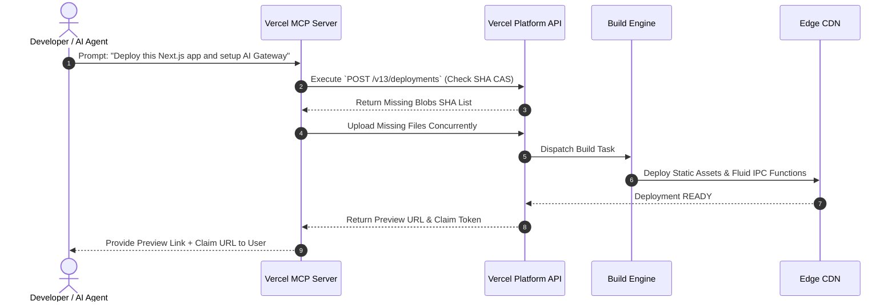

# Vercel Platform Architecture, Product Design & Infrastructure Analysis Report
> **Document Purpose**: Definitive technical reference and product design specification analyzing Vercel's platform ecosystem, UI/UX design language, deployment engine, and architecture, enhanced with official `vercel.com/docs.md` specifications for constructing a low-cost, developer-centric cloud hosting platform.

---

## 1. Platform Overview

### What Vercel Is
Vercel is an enterprise-grade **AI & Frontend Cloud Platform** for full-stack web applications, static sites, and autonomous AI agents. Originally founded as **Zeit** (creators of `now`), Vercel pioneered zero-configuration serverless web deployments and created **Next.js**, the industry-standard React framework.

Vercel functions as a unified platform combining global edge routing, automated CI/CD deployment pipelines, serverless and edge compute infrastructure, web analytics, storage primitives, security controls, and a dedicated **AI Agent & Developer Tooling Ecosystem** (AI Gateway, Vercel MCP Server, AI SDK, Sandbox, Workflows).

### Problems Vercel Solves
1. **Infrastructure Complexity Friction**: Eliminates manual provisioning of cloud servers, Nginx reverse proxies, SSL certificates, build runners, and CDN invalidation rules.
2. **Slow Developer & AI Feedback Loops**: Replaces manual staging environments with automatic **Preview Deployments** generated for every git commit, pull request, or agent execution.
3. **Frontend, Backend & AI Agent Fragmentation**: Unifies frontend static asset serving, backend serverless API routes, durable background workflows, and multi-model AI routing under a single domain and deployment lifecycle.
4. **Agent Integration Friction**: Provides standardized protocols (Vercel Plugin, Vercel MCP Server, Agent Skills) allowing AI coding agents (Claude Code, Cursor, GitHub Copilot, Codex) to deploy apps, search logs, manage projects, and issue short-lived OAuth tokens (`Vercel Connect`) securely.
5. **Global Latency & Performance Degradation**: Automatically caches static assets and executes edge compute code close to users across a global Anycast network.

### Target Users & Customer Segments
- **Individual Developers & Hobbyists**: Building personal projects, portfolios, and side projects with instant git-push deployments.
- **AI Engineers & Agent Developers**: Building LLM-powered applications, durable backend agents, and chat interfaces using Vercel AI Gateway and AI SDK.
- **Startups & High-Growth Scale-ups**: Leveraging fast iteration cycles, preview URLs, and serverless scalability without dedicated DevOps teams.
- **Enterprise Engineering Teams**: Requiring SSO/SAML, role-based access control (RBAC), Web Application Firewalls (WAF), Rolling Releases, multi-zone resiliency, custom SLA guarantees, and SOC2/ISO compliance.

### Main Use Cases
- **Full-Stack Web Applications**: Next.js, Remix, SvelteKit, Nuxt, Astro, and React Router applications combining SSR, SSG, and API endpoints.
- **Autonomous AI Agents & RAG Workflows**: Durable, stateful AI agents built with `eve`, Vercel Workflows, and Vercel Sandbox.
- **Microfrontends & Multi-Zone Applications**: Architectures where multiple independent repositories/deployments are routed under a unified primary domain.
- **Headless E-Commerce**: Next.js + Shopify/BigCommerce/Contentful setups with dynamic rendering and instant ISR revalidation.

### Vercel vs Traditional Hosting & Cloud Providers

| Platform | Architectural Model | Deployment Paradigm | AI Agent & Model Routing | Primary Target |
| :--- | :--- | :--- | :--- | :--- |
| **Vercel** | Serverless, Edge & AI Cloud | Git Push / CLI / MCP Agent | Built-in (AI Gateway, MCP, Sandbox) | Frontend, Full-Stack & AI Apps |
| **Traditional VPS (cPanel/LAMP)** | Monolithic Persistent Server | FTP / Manual SSH Deployment | None | Monolithic PHP/MySQL Apps |
| **AWS (EC2 / S3 + Bedrock)** | Raw Infrastructure (IaaS) | Pipeline Scripting / Terraform | Complex IAM & API Setup | General Enterprise Infrastructure |
| **Netlify** | Jamstack / Edge Cloud | Git Push / Drag-and-Drop | Add-on integrations | Jamstack & Static Sites |
| **Cloudflare Pages/Workers** | Edge Network Compute | Git Push / Wrangler CLI | AI Workers (Vectorize / Workers AI) | Edge-first workers & static sites |
| **Heroku / Railway / Render** | Container PaaS | Git Push / Dockerfile | None / Basic add-ons | Web apps, workers, databases |

---

## 2. Complete Feature Breakdown

```
                    +-------------------------------------------------------+
                    |                  VERCEL FEATURE MAP                   |
                    +-------------------------------------------------------+
                                                |
    +-------------------+-----------------------+-----------------------+-------------------+
    |                   |                       |                       |                   |
    v                   v                       v                       v                   v
+-------+           +-------+               +-------+               +-------+           +-------+
|  GIT  |           | COMPUTE|              |NETWORK|               |STORAGE|           |AI & AGENTS|
+-------+           +-------+               +-------+               +-------+           +-------+
| Repos |           |Node.js|               |  CDN  |               |  Blob |           |AI Gate|
|PR Rev |           |Python |               | Edge  |               |  KV   |           |AI SDK |
|Hooks  |           |Rust   |               | WAF   |               |Postgres|          |Sandbox|
|Rolling|           |Go/Ruby|               |BotID  |               |EdgeConf|          |MCP Svr|
+-------+           +-------+               +-------+               +-------+           +-------+
```

### 1. AI Infrastructure & Agent Suite [Officially Documented]
- **Vercel AI Gateway (`https://ai-gateway.vercel.sh/v1`)**: Unified model routing endpoint allowing applications to call hundreds of LLMs (Anthropic Claude, OpenAI, Pixel Canary, Meta Llama) via a single API key (`vercel ai-gateway api-keys create`), with built-in rate limits, fallback routing, and usage monitoring.
- **Vercel AI SDK**: TypeScript/JavaScript framework for building conversational UIs, AI agents, and structured outputs across Next.js, React, Svelte, Vue, and Node.js.
- **Vercel MCP Server (`https://mcp.vercel.com`)**: Model Context Protocol server enabling coding agents (Claude Code, Cursor, Copilot, Codex) to search documentation, query Web Analytics, stream build logs, and manage deployments.
- **Vercel Connect**: Issued short-lived OAuth tokens at runtime so AI agents can interact with third-party providers (Slack, GitHub, Microsoft, Snowflake, TanStack AI) without storing provider credentials in environment variables.
- **Claim Deployments**: API workflow allowing AI agents to generate app deployments on behalf of users and transfer ownership via a claim URL (`/docs/deployments/claim-deployments`).
- **Vercel Sandbox & Memory Observability**: Ephemeral, isolated execution environments for running untrusted agent-generated code with real-time memory usage telemetry via dashboard and CLI.
- **`eve` & Workflows SDK**: Open-source, filesystem-first durable backend agent framework and workflow engine for multi-step agent orchestration.

### 2. Core Compute & Deployment Suite [Officially Documented]
- **Projects & Git Automated CI/CD**: Automatic build triggers for GitHub, GitLab, and Bitbucket pushes.
- **Preview Deployments & Vercel Toolbar**: Live, isolated preview environments generated per branch/PR, featuring real-time comments, visual edits, and feature flag toggles.
- **Rolling Releases (Pro/Enterprise)**: Progressive traffic shifting (e.g. 5% -> 25% -> 100%) to validate production deployments before full promotion.
- **Instant Rollback**: Sub-second (300ms) DNS pointer swap reverting production to a known good build without rebuilding code.
- **Serverless & Edge Functions**: Handlers running on AWS Lambda or V8 isolates with Fluid Compute IPC streaming, supporting up to 900s execution limits on Enterprise.

### 3. Security & Bot Prevention [Officially Documented]
- **Web Application Firewall (WAF)**: Custom rules, IP blocking, rate-limiting directives, and country filters.
- **Bot Management & BotID**: Invisible bot detection and invisible checks replacing traditional CAPTCHAs on sensitive endpoints.
- **Deployment Protection**: SAML SSO, HTTP Basic Auth, and OAuth gating for preview environments.
- **Vercel Container Registry (VCR) OIDC**: `vercel/vcr-action/login` GitHub Action for passwordless container pushes via GitHub OIDC tokens.

---

## 3. Vercel Dashboard UI Analysis

### Layout & Navigation Structure
The Vercel Dashboard ([`vercel.com/dashboard`](https://vercel.com/dashboard)) uses a high-contrast **Scope-First, Contextual Tab Architecture**.

```
+-----------------------------------------------------------------------------------+
|  [Vercel Logo]  [Scope Switcher: Team v]   [Search / ]   [AI Assistant] [Avatar]  |
+-----------------------------------------------------------------------------------+
|  Overview  |  Integrations  |  Storage  |  Usage  |  AI Gateway  |  Settings      |
+-----------------------------------------------------------------------------------+
|                                                                                   |
|  [ Search Projects... ]      [ Filter by Framework v ]     [ Add New... v ]        |
|                                                                                   |
|  +---------------------------+  +---------------------------+  +----------------+  |
|  | Project Card 1            |  | Project Card 2            |  | Project Card 3 |  |
|  | - Next.js (Ready)         |  | - Remix (Building)        |  | - Agent (Ready)|  |
|  | - main -> app.vercel.app  |  | - dev -> app-dev.v.app    |  | - main         |  |
|  +---------------------------+  +---------------------------+  +----------------+  |
|                                                                                   |
+-----------------------------------------------------------------------------------+
```

- **Top Bar**: Scope selector (Personal vs Team), Global Command Palette (`Cmd + K`), AI Gateway Quick Access, and Notifications.
- **Scope Navigation Tabs**: `Overview`, `Integrations`, `Storage`, `Usage`, `AI Gateway` (model usage & API keys), `Settings`.
- **Project Navigation Tabs**: `Overview`, `Deployments`, `Analytics`, `Speed Insights`, `Logs`, `Storage`, `Settings`.
- **Deployment Detail View**: Displays embedded canvas preview iframe, terminal build log stream with line search, generated function routes list, and rolling release rollout controls.

---

## 4. UI/UX Design System (Vercel Geist)

Vercel's visual identity relies on **Geist**, a high-precision design system built for maximum legibility and zero visual noise.

```
+-----------------------------------------------------------------------------------+
|                              GEIST DESIGN TOKENS                                 |
+-----------------------------------------------------------------------------------+
|  COLORS:      #000000 (Black)  |  #FFFFFF (White)  |  #111111 (Dark Gray Surface) |
|               #888888 (Muted Gray Text)            |  #0070F3 (Vercel Electric Blue)|
|  TYPOGRAPHY:  Geist Sans (UI & Prose)               |  Geist Mono (Code & Logs)    |
|  BORDERS:     1px solid #333333 (Subtle Muted)      |  Radius: 6px (Standard Pill) |
+-----------------------------------------------------------------------------------+
```

- **Dark Mode Dominance**: High-contrast pitch-black backgrounds (`#000000`) paired with subtle container borders (`#333333`).
- **Dual Typography Engine**: `Geist Sans` for UI prose and `Geist Mono` for commit SHAs, logs, environment keys, and CLI commands.
- **Status Micro-Animations**: Pulsing yellow indicators for builds, vibrant green pills for `Ready` states, and crisp red badges for errors.

---

## 5. User Experience & Agent Journey Analysis



---

## 6. Information Architecture

```text
Vercel Platform Architecture
├── Dashboard & Workspaces (~/team-name)
│   ├── Overview (Project Cards Grid)
│   ├── Storage Hub (Blob, Postgres, KV, Edge Config)
│   ├── AI Gateway (~/team-name/ai-gateway)
│   │   ├── Model Usage & Budgets
│   │   ├── API Keys Management
│   │   └── Fallback Routing Rules
│   ├── Usage & Billing (Bandwidth, Execution Units, Storage)
│   └── Team Settings (SSO, Members, Audit Logs)
│
└── Project Workspace (~/team-name/project-name)
    ├── Overview (Live Canvas, Recent Deployments, Quick RUM)
    ├── Deployments (Ledger & Rolling Release Triggers)
    │   └── Deployment View (~/project-name/deployment-id)
    │       ├── Live Preview Canvas & Toolbar
    │       ├── Terminal Build Logs Stream
    │       └── Functions & Routes Inventory
    ├── Analytics & Speed Insights
    ├── Logs & Trace Viewer
    ├── Sandbox Observability (Memory & CPU Telemetry)
    └── Settings
        ├── General (Framework Preset, Build Commands)
        ├── Environment Variables
        ├── Custom Domains & Managed DNS
        ├── Security & WAF (BotID, IP Blocking, Password Protection)
        └── Integrations & Connectors (Vercel Connect OAuth Tokens)
```

---

## 7. Deployment Engine & Fluid Compute IPC Architecture

```
[ Git Push / Agent Action ] 
        |
        v
+-----------------------------------------------------------------------------------+
| 1. CAS DEDUPLICATION                                                              |
|    - Computes file SHA-1 checksums; uploads missing blobs via `async-sema`.        |
+-----------------------------------------------------------------------------------+
        |
        v
+-----------------------------------------------------------------------------------+
| 2. BUILD ORCHESTRATION                                                            |
|    - Isolated Linux container executes build command (`next build`).             |
|    - `@vercel/nft` static analysis bundles exact dependencies.                     |
|    - Emits Build Output API v3 specification (`.vercel/output/`).                 |
+-----------------------------------------------------------------------------------+
        |
        v
+-----------------------------------------------------------------------------------+
| 3. FLUID COMPUTE & EDGE PROPAGATION                                               |
|    - Functions talk over Unix domain socket (`VERCEL_IPC_PATH`).                  |
|    - Null-byte terminated JSON: `server-started \0`, `log \0`, `end \0`.         |
|    - Progressive Rolling Release shifts traffic percentages safely.               |
+-----------------------------------------------------------------------------------+
        |
        v
[ Live Deployment Ready ]
```

---

## 8. Architecture & Technical Concepts

- **Content-Addressed Storage (CAS)**: Deduplicates assets globally using SHA-1 file hashing.
- **Fluid Compute IPC Protocol**: Socket protocol enabling low-latency HTTP response streaming and multiplexing.
- **Vercel Connect**: Ephemeral token issuance service executing OAuth consent at route boundaries without persisting provider secrets in environment variables.
- **Vercel Sandbox & Memory Telemetry**: Ephemeral Docker-based sandboxes equipped with real-time memory observability for untrusted agent code.

---

## 9. Developer Experience (DX) Analysis

| Developer / Agent Friction Point | Traditional Solution | Vercel Platform Solution |
| :--- | :--- | :--- |
| **LLM Provider API Key Management** | Managing separate keys for OpenAI, Anthropic, Gemini in `.env`. | **AI Gateway**: Single API key (`ai-gateway.vercel.sh/v1`) with fallback rules. |
| **AI Agent Authentication** | Storing long-lived OAuth tokens for Slack/GitHub in DBs. | **Vercel Connect**: Runtime short-lived token issuance without storing secrets. |
| **Staging Environment Setup** | Provisioning dedicated QA servers. | **Preview Deployments**: Automatic URL per git branch or agent prompt. |
| **Production Rollout Risk** | All-at-once production deployment. | **Rolling Releases**: Progressive traffic shifting (5% -> 25% -> 100%). |
| **Production Rollback** | Re-running failed build pipelines. | **Sub-Second Rollback**: 300ms DNS pointer swap to previous successful build. |

---

## 10. CLI & Developer Tooling Architecture

```
                  +----------------------------------------------+
                  |    DEVELOPER / AI AGENT INTERFACE            |
                  +----------------------------------------------+
                                   |              |
                    +--------------+              +--------------+
                    |                                            |
                    v                                            v
     +------------------------------+             +------------------------------+
     |   Vercel Web Dashboard       |             |   Vercel CLI / MCP Server    |
     +--------------+---------------+             +--------------+---------------+
                    |                                            |
                    +--------------+--------------+--------------+
                                   |
                                   v
                  +----------------------------------------------+
                  |  Vercel REST API (v13/deployments, v9/proj)  |
                  +----------------------------------------------+
                                   |
                                   v
                  +----------------------------------------------+
                  |       Vercel Cloud Infrastructure Platform   |
                  +----------------------------------------------+
```

### Key Commands & Agent Tooling

| Command / Tool | Category | Purpose |
| :--- | :--- | :--- |
| `vercel deploy` | Deployment | Hashes project, uploads missing blobs, triggers preview build. |
| `vercel ai-gateway setup` | AI Gateway | Configures AI Gateway endpoint and API keys for LLM routing. |
| `npx -y add-mcp https://mcp.vercel.com` | MCP Integration | Connects Vercel MCP server to AI agents (Claude Code, Cursor, Copilot). |
| `npx plugins add vercel/vercel-plugin` | Agent Plugin | Installs deployment skills and slash commands for coding agents. |
| `vercel env pull` | Env Management | Downloads cloud environment variables into local `.env.local`. |
| `vercel rollback` | Recovery | Promotes previous deployment to production instantly. |

---

## 11. APIs, Connectors & AI Integrations

- **Vercel REST API (v13)**: Endpoints for deployments, projects, teams, DNS, firewall rules, and tokens.
- **Vercel Connect**: Runtime token gateway issuing temporary OAuth tokens for Slack, GitHub, Snowflake, Microsoft, and TanStack AI.
- **Vercel Container Registry (VCR) OIDC**: `vercel/vcr-action/login` GitHub Action for passwordless container pushes using GitHub OIDC identity.

---

## 12. Pricing & Usage Model Analysis

- **Hobby (Free)**: Personal projects, 100GB fast data transfer, standard serverless function execution.
- **Pro ($20 / seat / month)**: Team collaboration, 1TB bandwidth, password protection, Rolling Releases, Speed Insights.
- **Enterprise (Custom Quote)**: 99.99% SLAs, SAML SSO, custom WAF rules, isolated build infrastructure, SOC2 compliance.
- **Metered Dimensions**: Bandwidth, Serverless GB-Hours, Edge Invocations, Build Compute Minutes, AI Gateway Model Tokens.

---

## 13. Security Infrastructure

- **WAF & BotID**: Custom firewall rules, IP blocklists, and invisible bot verification (`BotID`) replacing CAPTCHAs.
- **Deployment Protection**: SAML SSO, password protection, and OAuth gating for preview environments.
- **OIDC Passwordless Registries**: Ephemeral token auth via GitHub OIDC for Vercel Container Registry (`vcr`).

---

## 14. Performance Engineering

- **Edge CDN & ISR**: Global Anycast edge nodes serving cached static assets with Stale-While-Revalidate background revalidation.
- **Image Optimization**: On-demand WebP/AVIF conversion and dynamic resizing (`next/image`).
- **AST Tree-Shaking (`@vercel/nft`)**: Eliminates unused `node_modules` code to minimize serverless cold starts.

---

## 15. Developer & AI UX Patterns

1. **Instant Agent Claim URLs**: Allows AI agents to deploy apps for users and pass ownership via a claim link.
2. **One-Endpoint Model Gateway**: Routes all LLM model calls through `ai-gateway.vercel.sh/v1` with unified credentials.
3. **Direct Source-to-Log Links**: Clickable log traces jumping straight to Git commit SHAs and line numbers.

---

## 16. Low-Cost Vercel-Inspired Platform Specification (ShanuTechX)

### Feature Implementation Roadmap & Matrix

| Feature | Phase | Priority | Infrastructure Requirement | Complexity | Dev Effort | Value |
| :--- | :--- | :--- | :--- | :--- | :--- | :--- |
| **Static Site Hosting** | MVP | P0 | Nginx / Traefik, Local Storage | Low | 2 Weeks | High |
| **Git Integration (GitHub)** | MVP | P0 | GitHub OAuth App, Webhook Handlers | Medium | 2 Weeks | Critical |
| **Containerized Build System** | MVP | P0 | Docker Engine API, Build Workers | High | 4 Weeks | Critical |
| **Automatic Managed SSL** | MVP | P0 | Caddy / Let's Encrypt ACME API | Medium | 1 Week | Critical |
| **Custom Subdomains** | MVP | P0 | Cloudflare DNS API | Medium | 1 Week | High |
| **Node.js Functions** | V2 | P1 | Docker Containers / OpenFaaS | High | 4 Weeks | High |
| **Preview Environments** | V2 | P1 | Dynamic Subdomain Router | Medium | 2 Weeks | High |
| **Real-Time Logs & WebSockets**| V2 | P1 | Redis Pub/Sub, xterm.js | Medium | 2 Weeks | High |
| **Env Secret Manager** | V2 | P1 | AES-256 Vault | Low | 1 Week | Critical |
| **Managed DBs (Supabase)** | V3 | P2 | Docker Compose Provisioner | High | 3 Weeks | High |
| **AI Gateway Proxy** | V3 | P2 | Express LLM Reverse Proxy | Medium | 2 Weeks | High |

---

## 17. Low-Cost Platform System Architecture

```
                                  [ USER / DEVELOPER / AGENT ]
                                               |
                                      +--------+--------+
                                      |                 |
                                      v                 v
                             +-----------------+  +-------------------+
                             |  Web Dashboard  |  |  CLI Tool (stx)   |
                             |  (Next.js 14)   |  |  (Node / Go CLI)  |
                             +--------+--------+  +---------+---------+
                                      |                     |
                                      +--------+------------+
                                               |
                                               v
                                   +-----------------------+
                                   |  API Gateway          |
                                   |  (Express / Fastify)  |
                                   +-----------+-----------+
                                               |
                   +---------------------------+---------------------------+
                   |                           |                           |
                   v                           v                           v
         +-------------------+       +-------------------+       +-------------------+
         | Auth Service      |       | Project Service   |       | Deployment Engine |
         | (Firebase/OAuth)  |       | (Prisma + Postgres|       | (Task Orchestration|
         +-------------------+       +-------------------+       +---------+---------+
                                                                           |
                                                                           v
                                                                 +-------------------+
                                                                 | BullMQ Queue      |
                                                                 | (Redis Managed)   |
                                                                 +---------+---------+
                                                                           |
                                                                           v
                                                                 +-------------------+
                                                                 | Build Worker Host |
                                                                 | (Docker Engine)   |
                                                                 +---------+---------+
                                                                           |
                                             +-----------------------------+-----------------------------+
                                             |                                                           |
                                             v                                                           v
                                   +-------------------+                                       +-------------------+
                                   | Object Storage    |                                       | Container Registry|
                                   | (MinIO / R2)      |                                       | (Local / Harbor)  |
                                   +---------+---------+                                       +---------+---------+
                                             |                                                           |
                                             +-----------------------------+-----------------------------+
                                                                           |
                                                                           v
                                                                 +-------------------+
                                                                 | Reverse Proxy Router|
                                                                 | (Traefik/Cloudflare|
                                                                 +---------+---------+
                                                                           |
                                                                           v
                                                                 [ LIVE USER APP ]
```

---

## 18. Suggested Technology Stack for Low-Cost Platform

- **Frontend UI**: Next.js 14 + Tailwind CSS + shadcn/ui.
- **Backend API**: Express.js (TypeScript) monorepo service.
- **Build Engine**: Docker Engine API running on VPS workers.
- **Routing & SSL**: Traefik or Nginx + Let's Encrypt + Cloudflare DNS API.
- **Database**: PostgreSQL 16 + Prisma ORM.
- **Queue**: BullMQ + Redis.
- **Object Storage**: Cloudflare R2 (zero egress costs) or self-hosted MinIO.

---

## 19. Strategic Comparison: Vercel vs Our Low-Cost Platform (ShanuTechX)

| Dimension | Vercel Platform | Low-Cost Student Platform (ShanuTechX) | Differentiating Advantage |
| :--- | :--- | :--- | :--- |
| **Primary Target** | Enterprise & Scale-ups | Students, Educators, Indie Developers | Low-cost predictability, no overage shock. |
| **Pricing Model** | Metered Usage (High Egress) | Fixed Low-Cost Monthly Cap / Free Tier | Predictable student-friendly pricing. |
| **Infrastructure** | Proprietary AWS + Anycast Edge | Self-Hosted VPS Nodes (Hetzner/DigitalOcean) | Extremely cheap operational overhead. |
| **Databases** | Managed Third-Party Integrations | Self-Hosted One-Click Supabase Stacks | Built-in Supabase stack management. |
| **AI Features** | AI Gateway + MCP Server | Integrated LLM Proxy & Agent Deployments | Native AI developer toolsuite. |

---

## 20. Phased Implementation Roadmap

- **Phase 1 — Core Hosting**: User auth, static file uploads, Traefik static routing.
- **Phase 2 — Git Deployments**: GitHub webhooks, Docker build pipeline, WebSocket logs.
- **Phase 3 — Domains & SSL**: Cloudflare DNS API, auto Let's Encrypt SSL.
- **Phase 4 — Secrets & Previews**: AES-256 vault, preview deployments per branch.
- **Phase 5 — Managed DBs & Templates**: One-click Postgres & Docker Compose templates.
- **Phase 6 — AI Gateway & Agent Tools**: Lightweight LLM proxy & MCP server integration.

---

## 21. Final Summary & Design Takeaways

1. **Vertical Integration**: Creating **Next.js** and the **Vercel AI SDK** provided Vercel with an unbeatable platform adoption flywheel.
2. **First-Class AI Agent Integration**: Standardizing protocols like the **Vercel MCP Server**, **Vercel Connect**, and **Vercel AI Gateway** positions Vercel as the premier cloud platform for both human developers and autonomous AI coding agents.
3. **Geist Design Precision**: Minimal visual noise, monospace typography alignment, and high-contrast dark mode create an ideal developer environment.
4. **Actionable Platform Takeaway**: A low-cost developer platform should combine Vercel's git-push deployment simplicity and Geist UI aesthetic with predictable, capped pricing and integrated self-hosted database stacks (Supabase).
