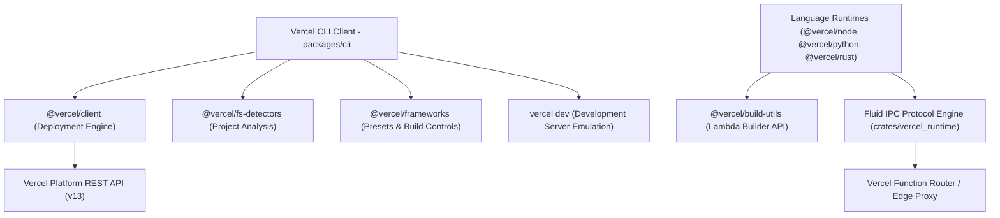

# Vercel Monorepo Architecture & Technical Documentation

> **Repository:** Vercel Monorepo (`vercel/vercel`)  
> **Source Root:** [`c:\Users\tiros\OneDrive\Desktop\shanutechx\references\vercel-main`](file:///c:/Users/tiros/OneDrive/Desktop/shanutechx/references/vercel-main)  
> **Package Ecosystem:** pnpm Workspaces + Turborepo + Rust Crates + Python Workspaces  
> **Primary Package:** [`vercel`](file:///c:/Users/tiros/OneDrive/Desktop/shanutechx/references/vercel-main/packages/cli) (Vercel CLI)  

---

## 1. Project Overview

### What the Project Is
The **Vercel Monorepo** (`vercel/vercel`) is the core open-source engine powering the Vercel cloud application platform toolchain. It houses:
1. **The Vercel Command Line Interface (`vercel` / `vc` CLI)**: The unified command-line tool used by millions of developers and CI systems to build, preview, link, inspect, and deploy applications to Vercel's global infrastructure.
2. **Official Builder & Runtime Engines**: Runtimes for Node.js ([`packages/node`](file:///c:/Users/tiros/OneDrive/Desktop/shanutechx/references/vercel-main/packages/node)), Python ([`packages/python`](file:///c:/Users/tiros/OneDrive/Desktop/shanutechx/references/vercel-main/packages/python) & [`python/vercel-runtime`](file:///c:/Users/tiros/OneDrive/Desktop/shanutechx/references/vercel-main/python/vercel-runtime)), Go ([`packages/go`](file:///c:/Users/tiros/OneDrive/Desktop/shanutechx/references/vercel-main/packages/go)), Ruby ([`packages/ruby`](file:///c:/Users/tiros/OneDrive/Desktop/shanutechx/references/vercel-main/packages/ruby)), Rust ([`packages/rust`](file:///c:/Users/tiros/OneDrive/Desktop/shanutechx/references/vercel-main/packages/rust) & [`crates/vercel_runtime`](file:///c:/Users/tiros/OneDrive/Desktop/shanutechx/references/vercel-main/crates/vercel_runtime)), and Static Sites ([`packages/static-build`](file:///c:/Users/tiros/OneDrive/Desktop/shanutechx/references/vercel-main/packages/static-build)).
3. **Framework Auto-Detection & Build Systems**: Preset configurations for 40+ web frameworks (Next.js, Remix, SvelteKit, Nuxt, Vite, Astro, Gatsby, Redwood, etc.) and filesystem detection logic ([`packages/frameworks`](file:///c:/Users/tiros/OneDrive/Desktop/shanutechx/references/vercel-main/packages/frameworks), [`packages/fs-detectors`](file:///c:/Users/tiros/OneDrive/Desktop/shanutechx/references/vercel-main/packages/fs-detectors)).
4. **Fluid Compute & IPC Protocol Engine**: High-performance streaming TCP/Unix socket Inter-Process Communication protocols connecting language runtimes with Vercel's routing infrastructure ([`crates/vercel_runtime`](file:///c:/Users/tiros/OneDrive/Desktop/shanutechx/references/vercel-main/crates/vercel_runtime), [`internals/ipc-proxy`](file:///c:/Users/tiros/OneDrive/Desktop/shanutechx/references/vercel-main/internals/ipc-proxy)).
5. **AI Agent & Model Context Protocol (MCP) Integration**: Embedded MCP server toolings, agent guidance systems, and AI Gateway primitives ([`packages/cli/src/commands/agent`](file:///c:/Users/tiros/OneDrive/Desktop/shanutechx/references/vercel-main/packages/cli/src/commands/agent), [`packages/cli/src/commands/mcp`](file:///c:/Users/tiros/OneDrive/Desktop/shanutechx/references/vercel-main/packages/cli/src/commands/mcp)).
6. **Native Binary Distribution**: Standalone pre-compiled native CLI binaries (`@vercel/vc-native`) built with Rust/Node native wrappers to eliminate runtime bootstrap overhead.

### What Problem It Solves
Deploying modern multi-framework applications to serverless and edge infrastructure traditionally involves complex Dockerfiles, manual CloudFront/S3 configuration, serverless wrapper boilerplate, and environment variable synchronization drift. 

The Vercel monorepo solves this by providing:
- **Zero-Config Deployment**: Automatically detects project frameworks, build commands, and output directories.
- **Unified Build Output API (v3)**: Standardizes how any framework outputs static assets, serverless functions, edge functions, and routing rules.
- **Local Infrastructure Emulation**: `vercel dev` emulates Vercel's production routing, edge functions, serverless Lambdas, headers, and environment variables locally.
- **Fast Content-Addressed Asset Delivery**: Deduplicates project files using SHA-1 hashing, uploading only changed files during deployments.
- **Fluid Compute IPC**: Replaces legacy HTTP proxy overhead with a null-byte-terminated Unix/TCP IPC socket protocol for low-latency HTTP streaming and multiplexing.

### Who It Is Designed For
- **Frontend & Full-Stack Developers**: Building web applications using Next.js, React, Vue, Svelte, Nuxt, Astro, Remix, and Node/Python backends.
- **DevOps & Platform Engineers**: Orchestrating CI/CD pipelines, preview environments, custom domains, DNS, firewall rules, and container registries.
- **AI Agents & LLM Assistants**: Operating autonomously via non-interactive JSON CLI mode, MCP servers (`vercel mcp`), and structured diagnostic outputs.

---

## 2. Features

### Module-Based Feature Overview



#### 1. CLI Core Engine & Command Dispatcher (`packages/cli`)
- **Interactive & Non-Interactive Execution**: Supports rich terminal UIs (`@inquirer/*`, `ora`, `chalk`) while seamlessly switching to machine-readable JSON outputs when invoked by CI/CD or AI agents.
- **Project & Repository Linking**: Manages `.vercel/project.json` (single project) and `.vercel/repo.json` (monorepos) to map local workspace paths to remote Vercel projects.
- **Deployment Orchestration**: Packages project assets, tree-shakes serverless functions using `@vercel/nft`, uploads missing file blobs, and streams deployment build logs in real time.
- **Environment & Secrets Manager**: Features `vercel env pull`, `vercel env add`, `vercel env ls`, supporting `.env.local`, custom environments (Preview, Production, Development), and encrypted vault secrets.

#### 2. Framework Detection & Build Presets (`packages/frameworks`, `packages/fs-detectors`)
- **Automatic Framework Recognition**: Inspects `package.json`, dependency trees, and config files to identify 40+ frameworks (Next.js, Vite, Nuxt, SvelteKit, Remix, Gatsby, Astro, Hugo, Jekyll, Zola, etc.).
- **Build Output Standardizer**: Configures default build commands, dev server ports, output directories (`.next`, `dist`, `build`, `public`), and rewrite/redirect schemas.
- **Package Manager Detection**: Auto-detects package managers (`pnpm`, `npm`, `yarn`, `bun`), lockfiles (`pnpm-lock.yaml`, `package-lock.json`, `yarn.lock`, `bun.lockb`), and workspace boundaries.

#### 3. Builder API v3 & Serverless Function Packaging (`packages/build-utils`)
- **Virtual File System (VFS)**: Abstraction around project files using `Files`, `FileFsRef` (filesystem reference), `FileBlob` (in-memory data), and `FileRef` (remote checksum).
- **Lambda Function Generator**: `createLambda()` packages handler scripts, node_modules dependencies, execution runtimes (`nodejs22.x`, `python3.12`, `executable`), and environment wrappers into deployable serverless packages.
- **Build Artifact Caching**: `prepareCache()` persists dependency trees (`node_modules`, `.cache`, `pip` download caches) between deployment runs.

#### 4. Multi-Language Runtime Ecosystem
- **Node.js Runtime (`@vercel/node`)**: Compiles TypeScript/JavaScript handlers, supports ESM/CJS, injects helper utilities, and supports response streaming.
- **Python Runtime (`@vercel/python` & `python/vercel-runtime`)**: Implements ASGI/WSGI adapters, supports Python 3.12+, manages virtual environments with `uv`, and packages dependencies.
- **Rust Runtime (`@vercel/rust` & `crates/vercel_runtime`)**: Compiles Rust handlers into native AL2023 executables using Cargo, integrating Axum and Actix web framework bindings with Fluid IPC.
- **Go (`@vercel/go`) & Ruby (`@vercel/ruby`) Runtimes**: Provide serverless handler compilation and execution wrappers for Go and Ruby code bases.
- **Static Build Engine (`@vercel/static-build`)**: Executes framework SSG (Static Site Generation) builds and collects static HTML/JS/CSS assets.

#### 5. Fluid Compute & IPC Streaming Protocol (`crates/vercel_runtime`, `.claude/skills/vercel-runtime-implementation-guide.md`)
- **TCP/Unix Socket IPC**: Communicates between Vercel's Function Router and worker processes over a null-byte (`\0`) terminated JSON socket protocol.
- **Streaming & Multiplexing**: Enables chunked HTTP response streaming, concurrent request execution, and low-latency metrics reporting.
- **Internal Context Propagation**: Injects and sanitizes tracing headers (`x-vercel-internal-invocation-id`, `x-vercel-internal-request-id`).
- **Health Verification**: Responds to `/_vercel/ping` HTTP health check probes without dirtying IPC log buffers.

#### 6. Microfrontends, Security, Storage & Infrastructure Management
- **Vercel Container Registry (VCR) & Sandbox (`packages/container`, `sandbox`)**: Manages OCI container builds, Docker/Podman registry logins, and isolated code execution sandboxes.
- **Web Application Firewall (WAF) & Security (`packages/firewall`, `packages/cli/src/commands/firewall`)**: Configures custom WAF rules, IP blocking, rate-limiting, and challenge rules directly from the CLI.
- **Edge Storage & Integrations (`@vercel/blob`, `@vercel/connect`)**: Connects databases (Neon PostgreSQL, Supabase, Redis), manages Vercel Blob storage buckets, and handles Edge Config KV stores.
- **Feature Flags (`packages/cli/src/commands/flags`)**: Manages flag definitions, percentage rollouts, user segment targeting, and client SDK keys.

---

## 3. Technology Stack

| Category | Technologies / Tools | Purpose & Justification |
| :--- | :--- | :--- |
| **Primary Languages** | TypeScript (v5.9+), JavaScript (ES2022 / Node 20+), Rust (Edition 2021), Python (v3.12+) | End-to-end type safety across CLI & Node runtimes; high-performance compiled IPC runtime in Rust; Python runtime support using modern `uv` tooling. |
| **Monorepo Build Engine** | pnpm Workspaces (v10.29), Turborepo (v2.10) | Task graph orchestration, incremental builds, remote and local task caching, dependency graph management across 48+ packages. |
| **CLI Runtime & Tools** | Node.js (>= 18), `@yao-pkg/pkg`, Esbuild (v0.27), Biome (v2.4) | Fast TypeScript compilation, native binary packaging, ultra-fast linting and formatting replacing ESLint/Prettier. |
| **Runtime Libraries** | Vitest (v4.1), Undici (v5.29), Zod (v4.1), Jose (v5.9), Smol-Toml | Unit & E2E testing framework; high-performance HTTP client; schema validation; JWT/OIDC signing; TOML/YAML parsers. |
| **Rust Crates** | Tokio, Axum, Actix-Web, Serde, Hyper | Async I/O, web framework adapters, ultra-fast JSON serialization for Fluid compute IPC. |
| **Python Ecosystem** | `uv`, `ruff`, `pytest`, `mypy`, `basedpyright` | Next-generation Python package management, linting, formatting, and strict static type verification. |
| **Cloud Services & APIs** | Vercel Platform REST API (v13), Cloudflare DNS, AWS Lambda, OCI Registries | Global deployment orchestration, DNS A-record & CNAME management, serverless execution infrastructure, container hosting. |

---

## 4. Architecture

### Overall System Architecture

The Vercel monorepo operates as a multi-tier architecture spanning developer endpoints, build pipeline builders, and cloud runtime infrastructure.

```
+-----------------------------------------------------------------------------------+
|                                 DEVELOPER ENDPOINT                                |
|                                                                                   |
|  +-----------------------------------------------------------------------------+  |
|  |                          Vercel CLI (packages/cli)                          |  |
|  |  [Commands: deploy, dev, env, link, firewall, flags, vcr, mcp, agent...]    |  |
|  +---------------------+-------------------------------+-----------------------+  |
|                        |                               |                          |
|                        v                               v                          |
|    +-----------------------+               +-----------------------+              |
|    | @vercel/fs-detectors  |               |  @vercel/frameworks   |              |
|    | (Project Analyzer)    |               |  (Preset Engine)      |              |
|    +-----------+-----------+               +-----------+-----------+              |
|                |                                       |                          |
+----------------|---------------------------------------|--------------------------+
                 |                                       |
                 +-------------------+-------------------+
                                     |
                                     v
+------------------------------------+----------------------------------------------+
|                             BUILD & DEPLOYMENT LAYER                              |
|                                                                                   |
|  +-----------------------------------------------------------------------------+  |
|  |                            @vercel/client SDK                               |  |
|  |  1. Hashes all workspace files (SHA-1)                                      |  |
|  |  2. Calls POST /v13/deployments (Identifies missing file blobs)             |  |
|  |  3. Uploads missing blobs concurrently (async-sema)                         |  |
|  |  4. Polls deployment build status                                           |  |
|  +-------------------------------------+---------------------------------------+  |
|                                        |                                          |
+----------------------------------------|------------------------------------------+
                                         |
                                         v
+----------------------------------------+------------------------------------------+
|                            PLATFORM & RUNTIME EXECUTION                           |
|                                                                                   |
|  +-----------------------------------------------------------------------------+  |
|  |                            Builder API v3 Engines                           |  |
|  |  @vercel/node  |  @vercel/python  |  @vercel/rust  |  @vercel/static-build    |  |
|  |  (Bundles handlers into AWS Lambda / Edge Function artifacts)               |  |
|  +-------------------------------------+---------------------------------------+  |
|                                        |                                          |
|                                        v                                          |
|  +-----------------------------------------------------------------------------+  |
|  |                       Fluid Compute IPC Protocol                            |  |
|  |  - Function Router <---> Unix Socket (VERCEL_IPC_PATH)                        |  |
|  |  - Null-byte terminated JSON: server-started \0, end \0, log \0              |  |
|  |  - Rust core crate (crates/vercel_runtime) streams response chunks           |  |
|  +-----------------------------------------------------------------------------+  |
|                                                                                   |
+-----------------------------------------------------------------------------------+
```

### Communication Between Components
1. **CLI -> Vercel Platform REST API**: Communicates over HTTPS using Bearer tokens (`Authorization: Bearer <token>`) targeting endpoints under `/v13/deployments`, `/v9/projects`, `/v2/teams`, and `/v1/flags`.
2. **CLI -> Local Dev Server (`vercel dev`)**: Spawns HTTP worker processes (`child_process.spawn`) for entrypoint routes, proxying requests through a local HTTP router that emulates edge routing rules and header transformations.
3. **Builder -> Lambda Artifacts**: Builders implement the `version = 3` interface (`build()`, `prepareCache()`), receiving a virtual file tree (`Files`) and returning `Lambda` objects containing compressed handler code and runtime metadata.
4. **Language Runtime -> Function Router**: Operates over Unix domain sockets specified by `VERCEL_IPC_PATH`. Handlers emit structured IPC JSON payloads (`server-started`, `log`, `end`) separated by `\0` string terminators.

---

## 5. Technical Implementation

### Important Implementation Techniques & Patterns

#### 1. Content-Addressed File Deduplication & Upload Engine
- **File Hashing**: Every file in a project is read as a stream, hashed using SHA-1, and assigned a permission mode string (`100644` for normal files, `100755` for executables).
- **Blob Re-use**: When initiating a deployment via `POST /v13/deployments`, the platform returns a list of SHA-1 digests missing from Vercel's global CAS (Content Addressable Storage).
- **Parallel Uploads**: Missing blobs are uploaded concurrently using [`packages/client/src/upload.ts`](file:///c:/Users/tiros/OneDrive/Desktop/shanutechx/references/vercel-main/packages/client/src/upload.ts) throttled by `async-sema` concurrency semaphores.

#### 2. Virtual File System (VFS) Abstraction
Defined in [`packages/build-utils`](file:///c:/Users/tiros/OneDrive/Desktop/shanutechx/references/vercel-main/packages/build-utils), the VFS abstracts disk storage away from builders:
- **`FileFsRef`**: Represents a physical file path on disk (`fsPath`, `mode`).
- **`FileBlob`**: Represents an in-memory buffer or string (`data`, `mode`).
- **`FileRef`**: Represents a remote platform file by its SHA digest (`digest`, `mode`).
- **`Lambda`**: Encapsulates a complete Serverless Function, including its internal `Files` map, `handler` entrypoint, runtime identifier (e.g. `nodejs22.x`), and environment variables.

#### 3. Fluid Compute IPC Protocol Contract
Implemented in Rust ([`crates/vercel_runtime/src/ipc/`](file:///c:/Users/tiros/OneDrive/Desktop/shanutechx/references/vercel-main/crates/vercel_runtime/src/ipc)) and Node/Python runtimes:
- **Initialization**: Upon binding the local HTTP server, the runtime opens a connection to `VERCEL_IPC_PATH` and sends:
  ```json
  { "type": "server-started", "payload": { "initDuration": 120, "httpPort": 3000 } }\0
  ```
- **Context Extraction**: Per request, context headers (`x-vercel-internal-invocation-id`, `x-vercel-internal-request-id`) are stripped before passing the request to developer handlers.
- **Log Streaming**: Standard output and standard error are intercepted, base64 encoded, and transmitted over IPC:
  ```json
  { "type": "log", "payload": { "context": { "invocationId": "..." }, "message": "SGVsbG8=", "stream": "stdout" } }\0
  ```
- **Completion Signal**: Upon response completion, an `end` frame is dispatched:
  ```json
  { "type": "end", "payload": { "context": { "invocationId": "..." }, "error": null } }\0
  ```

#### 4. Tree-Shaking & Dependency Tracing (`@vercel/nft`)
To keep serverless function zip archives lightweight, Vercel builders use Node File Trace (`@vercel/nft`). It statically analyzes AST import declarations (`require`, `import()`, `fs.readFile`) to bundle only the exact `.js` files and native `.node` modules required for execution, skipping unused dependencies inside `node_modules`.

---

## 6. Codebase Structure

### Monorepo Layout Overview

```
vercel-main/
├── .changeset/                # Monorepo versioning & changelog generation
├── .claude/skills/            # Agent implementation guides (Fluid protocol docs)
├── api/                       # Vercel internal deployment script & API schemas
├── crates/                    # Rust crates workspace
│   └── vercel_runtime/        # Rust Fluid IPC runtime library (Actix/Axum bindings)
├── internals/                 # Internal shared monorepo packages
│   ├── builder-orchestration/ # Builder pipeline orchestration
│   ├── cli-builder-integration/# CLI & builder IPC bridge helpers
│   ├── ipc-proxy/             # Fluid IPC socket proxy server
│   ├── service-topology/      # Infrastructure service endpoints & network config
│   └── types/                 # Shared TypeScript interfaces
├── packages/                  # Public npm packages (@vercel scope)
│   ├── build-utils/           # Core Builder API v3, Lambda & VFS primitives
│   ├── cli/                   # Main Vercel CLI codebase (69+ commands)
│   ├── cli-auth/              # OAuth authentication & credentials store
│   ├── cli-config/            # Project & global configuration managers
│   ├── client/                # @vercel/client REST API deployment SDK
│   ├── edge/                  # Edge runtime SDK utilities
│   ├── firewall/              # WAF & Firewall management primitives
│   ├── frameworks/            # 40+ framework preset definitions
│   ├── fs-detectors/          # Workspace & framework auto-detection
│   ├── functions/             # @vercel/functions SDK (geolocation, waitUntil)
│   ├── node/                  # @vercel/node builder for Node.js functions
│   ├── python/                # @vercel/python builder for Python
│   ├── routing-utils/         # Route matching, redirects, headers & rewrites
│   ├── rust/                  # @vercel/rust builder for Rust executables
│   ├── static-build/          # @vercel/static-build builder for SSG/HTML
│   └── vc-native/             # Standalone native CLI binary installer
├── python/                    # Python workspace
│   ├── vercel-runtime/        # Python Fluid IPC runtime engine & WSGI/ASGI wrapper
│   └── vercel-workers/        # Python worker thread pool management
├── scripts/                   # Workspace build, release, and trace scripts
├── skills/                    # Agent skills directory for Vercel CLI operations
├── utils/                     # CI publishing, packaging & artifact generators
├── DEVELOPING_A_RUNTIME.md    # Builder API v3 technical reference manual
├── package.json               # Monorepo root configuration & pnpm scripts
├── pnpm-workspace.yaml        # Workspace directory definitions
└── turbo.json                 # Turborepo task graph execution pipelines
```

### Core Entry Points
- **Vercel CLI Execution Entry**: [`packages/cli/src/index.ts`](file:///c:/Users/tiros/OneDrive/Desktop/shanutechx/references/vercel-main/packages/cli/src/index.ts) -> [`packages/cli/src/vc.js`](file:///c:/Users/tiros/OneDrive/Desktop/shanutechx/references/vercel-main/packages/cli/src/vc.js)
- **Deployment SDK Entry**: [`packages/client/src/deploy.ts`](file:///c:/Users/tiros/OneDrive/Desktop/shanutechx/references/vercel-main/packages/client/src/deploy.ts)
- **Framework Preset Registry**: [`packages/frameworks/src/frameworks.ts`](file:///c:/Users/tiros/OneDrive/Desktop/shanutechx/references/vercel-main/packages/frameworks/src/frameworks.ts)
- **Node.js Builder Entry**: [`packages/node/src/index.ts`](file:///c:/Users/tiros/OneDrive/Desktop/shanutechx/references/vercel-main/packages/node/src/index.ts)
- **Rust Fluid IPC Runtime Entry**: [`crates/vercel_runtime/src/lib.rs`](file:///c:/Users/tiros/OneDrive/Desktop/shanutechx/references/vercel-main/crates/vercel_runtime/src/lib.rs)
- **Python Fluid IPC Runtime Entry**: [`python/vercel-runtime/src/vercel_runtime/index.py`](file:///c:/Users/tiros/OneDrive/Desktop/shanutechx/references/vercel-main/python/vercel-runtime)

---

## 7. Feature-by-Feature Breakdown

### Feature 1: Project Deployment Pipeline (`vercel deploy` / `vercel --prod`)
- **Purpose**: Compiles, packages, and deploys local codebases to Vercel's global infrastructure.
- **User-Facing Behavior**: Command executes file hashing, shows build progress bars, uploads missing files, triggers cloud build jobs, and returns live deployment URLs (`https://<project>-<hash>.vercel.app`).
- **Relevant Files**: 
  - [`packages/cli/src/commands/deploy/index.ts`](file:///c:/Users/tiros/OneDrive/Desktop/shanutechx/references/vercel-main/packages/cli/src/commands/deploy)
  - [`packages/client/src/deploy.ts`](file:///c:/Users/tiros/OneDrive/Desktop/shanutechx/references/vercel-main/packages/client/src/deploy.ts)
  - [`packages/client/src/upload.ts`](file:///c:/Users/tiros/OneDrive/Desktop/shanutechx/references/vercel-main/packages/client/src/upload.ts)
- **Internal Implementation**:
  1. Resolves target project context from `.vercel/project.json`.
  2. Runs `detectFramework()` and `detectBuilders()` to establish required builders.
  3. Computes SHA-1 file digests for all workspace files.
  4. Calls `POST /v13/deployments` with file map and build targets.
  5. Concurrently uploads missing files via `upload.ts` using `async-sema`.
  6. Polls `GET /v13/deployments/:id` until state reaches `READY` or `ERROR`.
- **Security Considerations**: Ensures sensitive files listed in `.gitignore` or `.vercelignore` are filtered out before hashing.

### Feature 2: Local Infrastructure Emulation (`vercel dev`)
- **Purpose**: Runs a local HTTP server emulating Vercel's edge routing, environment variables, serverless function invocation, and header rules.
- **User-Facing Behavior**: Developer starts `vercel dev`, accesses `http://localhost:3000`, and sees instant reloads with real serverless function execution.
- **Relevant Files**:
  - [`packages/cli/src/commands/dev/index.ts`](file:///c:/Users/tiros/OneDrive/Desktop/shanutechx/references/vercel-main/packages/cli/src/commands/dev)
  - [`packages/node/src/dev-server.ts`](file:///c:/Users/tiros/OneDrive/Desktop/shanutechx/references/vercel-main/packages/node)
- **Internal Implementation**:
  1. Reads framework configuration and launches the framework's native dev server on an internal port.
  2. Monitors function routes in `api/` or `app/api/`.
  3. When an API route is hit, invokes the runtime's optional `startDevServer()` export, spawning single-serve or persistent worker child processes communicating over HTTP/IPC pipes.
- **Edge Cases**: Handles WebSocket upgrades, custom headers, and streaming responses locally.

### Feature 3: Project & Monorepo Linking (`vercel link`)
- **Purpose**: Connects a local workspace directory to a remote Vercel project and team.
- **User-Facing Behavior**: Guides developer through team selection, project creation or selection, generating `.vercel/project.json` or `.vercel/repo.json`.
- **Relevant Files**:
  - [`packages/cli/src/commands/link/index.ts`](file:///c:/Users/tiros/OneDrive/Desktop/shanutechx/references/vercel-main/packages/cli/src/commands/link)
  - [`packages/cli-config/src/index.ts`](file:///c:/Users/tiros/OneDrive/Desktop/shanutechx/references/vercel-main/packages/cli-config)
- **Internal Implementation**:
  - Distinguishes single-project links (`.vercel/project.json`) from monorepo root links (`.vercel/repo.json`).
  - `repo.json` maps directory paths to individual Vercel project IDs.
  - In non-interactive mode, resolves project targets automatically or aborts with `link_required` if ambiguous.

### Feature 4: Web Application Firewall (WAF) Control (`vercel firewall`)
- **Purpose**: Inspects, creates, updates, and deletes WAF security rules, rate-limiting directives, and IP block lists.
- **User-Facing Behavior**: CLI command `vercel firewall ls`, `vercel firewall add` allowing engineers to block malicious IPs or mitigate DDoS attacks.
- **Relevant Files**:
  - [`packages/cli/src/commands/firewall/index.ts`](file:///c:/Users/tiros/OneDrive/Desktop/shanutechx/references/vercel-main/packages/cli/src/commands/firewall)
  - [`packages/firewall/src/index.ts`](file:///c:/Users/tiros/OneDrive/Desktop/shanutechx/references/vercel-main/packages/firewall)
- **APIs Involved**: `GET /v1/security/firewall/rules`, `POST /v1/security/firewall/rules`.

---

## 8. Database & Data Models

While the Vercel monorepo is a client/runtime SDK and CLI, it interacts with platform data entities via REST API schemas and maintains local persistent JSON state models.

### Local Configuration Models

#### 1. Project Configuration (`.vercel/project.json`)
```json
{
  "orgId": "team_123456789",
  "projectId": "prj_987654321",
  "settings": {
    "createdAt": 1700000000000,
    "framework": "nextjs",
    "devCommand": null,
    "buildCommand": null,
    "outputDirectory": null,
    "rootDirectory": null
  }
}
```

#### 2. Monorepo Repository Mapping (`.vercel/repo.json`)
```json
{
  "orgId": "team_123456789",
  "remoteUrl": "https://github.com/my-org/my-monorepo.git",
  "projects": [
    { "id": "prj_web123", "name": "web-app", "directory": "apps/web" },
    { "id": "prj_docs456", "name": "docs-app", "directory": "apps/docs" }
  ]
}
```

#### 3. Global Auth Store (`~/.config/com.vercel.cli/auth.json`)
```json
{
  "token": "usr_tok_abcdef123456789"
}
```

### Remote API Object Schemas

#### 1. Deployment Object (Simplified)
- `id` (string): Unique deployment identifier (`dpl_...`).
- `name` (string): Project name.
- `url` (string): Primary preview domain URL.
- `state` (enum): `INITIALIZING` | `BUILDING` | `READY` | `ERROR` | `CANCELED`.
- `readyState` (enum): Similar to `state`.
- `files` (array): Array of file objects containing `file` path, `sha` hash, `size`, `mode`.
- `routes` (array): Array of route definitions (`src`, `dest`, `headers`, `status`, `middleware`).
- `builds` (array): List of builder execution records.

---

## 9. API Documentation

The Vercel CLI communicates with Vercel's backend platform via standard HTTP REST endpoints.

### Key API Endpoints Used by CLI

| Endpoint | Method | Purpose | Authentication |
| :--- | :--- | :--- | :--- |
| `/v13/deployments` | `POST` | Creates a new deployment draft and returns list of missing file SHA hashes. | Bearer Token |
| `/v2/now/files` | `POST` | Uploads a raw missing file blob identified by `x-now-digest` SHA header. | Bearer Token |
| `/v13/deployments/:id` | `GET` | Retrieves full deployment state, build logs, and status. | Bearer Token |
| `/v9/projects` | `GET` / `POST` | Lists or creates Vercel projects under the current team scope. | Bearer Token |
| `/v2/teams` | `GET` | Fetches user's active team memberships and role permissions. | Bearer Token |
| `/v1/flags` | `GET` / `POST` | Interacts with feature flag definitions and segment splits. | Bearer Token |
| `/v1/security/firewall/rules` | `GET` / `POST` | Queries and mutates WAF rules for a project. | Bearer Token |
| `/_vercel/ping` | `GET` | Health check endpoint executed locally or in Fluid compute instances. | None |

---

## 10. Authentication & Security

### Authentication Mechanisms
1. **OAuth2 Bearer Tokens**: Standard authentication via `Authorization: Bearer <VERCEL_TOKEN>`.
2. **Interactive Browser Login (`vercel login`)**: Opens an OAuth device authorization code flow or browser redirect, storing the resulting access token in `~/.config/com.vercel.cli/auth.json`.
3. **OIDC AWS Identity Federation (`@vercel/oidc-aws-credentials-provider`)**: Generates ephemeral OIDC tokens during cloud build execution, allowing serverless functions to authenticate securely with AWS IAM without static access keys.

### Security & Non-Interactive Safety Guardrails
- **Ignored Files filtering**: Automatically respects `.gitignore`, `.vercelignore`, `.env`, `.env.local`, and SSH private key file patterns, ensuring local secrets are never uploaded to Vercel's deployment CAS.
- **Header Sanitization**: Strictest isolation for Fluid compute context headers (`x-vercel-internal-*`). The runtime strips these headers before user code receives the HTTP request object.
- **Fail-Closed Non-Interactive Mode**: When executed in CI or by AI agents, CLI commands accept `--non-interactive`. If mandatory confirmations or ambiguous project links occur, the CLI immediately outputs a structured error JSON object and exits with non-zero code instead of hanging.

---

## 11. Deployment & Infrastructure

### How the Monorepo Packages are Built & Published
1. **Compilation**: Handled by Turborepo (`turbo run build`). TypeScript source in `packages/*/src` is compiled to JavaScript ESM/CJS and `.d.ts` declaration files using `esbuild` and `tsc`.
2. **Changeset Versioning**: Changeset CLI (`@changesets/cli`) manages semantic versioning (`patch`, `minor`, `major`). Every PR requires a `.changeset/*.md` file.
3. **Builder Pinning**: During CLI release packaging (`npm pack`), `scripts/pin-builders.mjs` converts `workspace:*` dependencies for embedded builders into explicit pinned npm version strings.
4. **Native Binaries (`@vercel/vc-native`)**: Built by compiling native Node.js binaries using `@yao-pkg/pkg` or Cargo for platform targets (`darwin-x64`, `darwin-arm64`, `linux-x64`, `win32-x64`).

---

## 12. Dependencies

### Critical Workspace & External Dependencies

| Package Name | Purpose / Function in Monorepo | Criticality |
| :--- | :--- | :--- |
| [`@vercel/build-utils`](file:///c:/Users/tiros/OneDrive/Desktop/shanutechx/references/vercel-main/packages/build-utils) | Standard types (`Lambda`, `FileFsRef`), helper functions (`createLambda`, `glob`, `download`), VFS implementation. | **Core Critical** |
| [`@vercel/client`](file:///c:/Users/tiros/OneDrive/Desktop/shanutechx/references/vercel-main/packages/client) | Low-level deployment engine, file hashing, concurrent blob uploader, status poller. | **Core Critical** |
| [`@vercel/frameworks`](file:///c:/Users/tiros/OneDrive/Desktop/shanutechx/references/vercel-main/packages/frameworks) | Registry of presets for 40+ web frameworks. | **Core Critical** |
| [`@vercel/fs-detectors`](file:///c:/Users/tiros/OneDrive/Desktop/shanutechx/references/vercel-main/packages/fs-detectors) | Framework, workspace, package manager, and monorepo auto-detectors. | **Core Critical** |
| [`@vercel/routing-utils`](file:///c:/Users/tiros/OneDrive/Desktop/shanutechx/references/vercel-main/packages/routing-utils) | Converts `vercel.json` rewrites, redirects, and headers into platform route objects. | **Core Critical** |
| `esbuild` | Ultra-fast JS/TS bundler for CLI build pipelines. | High |
| `vitest` | Unit and integration test runner across JavaScript/TypeScript packages. | High |
| `@biomejs/biome` | Fast code linter and formatter enforcing codebase style rules. | High |
| `zod` | Runtime type assertion and schema validation. | High |
| `undici` | Node.js high-performance HTTP/1.1 and HTTP/2 client for REST API communication. | High |

---

## 13. Development Workflow

### Quick Start Guide for Developers

```bash
# 1. Clone the repository
git clone https://github.com/vercel/vercel.git
cd vercel

# 2. Enable Corepack and install dependencies with pnpm
corepack enable
pnpm install

# 3. Build all workspace packages
pnpm build

# 4. Run type checks and linters
pnpm type-check
pnpm lint

# 5. Run unit test suite
pnpm test-unit
```

### Running Local CLI Changes Against Any External Project
To test local changes made to `packages/cli` against an external project directory on your machine:

```bash
cd packages/cli
pnpm vercel deploy --cwd /path/to/my-test-app
```

---

## 14. Performance & Scalability

### Optimization Techniques
1. **Parallel Upload Semaphore**: Uploads missing files in parallel using `async-sema` to saturate network bandwidth without hitting socket exhaustion.
2. **AST-Based Tree Shaking (`@vercel/nft`)**: Eliminates dead code in `node_modules` before zipping serverless functions, decreasing function cold-start times significantly.
3. **Fluid Compute Null-Byte IPC**: Replaces heavy HTTP server proxies with light Unix socket byte streaming (`\0` delimiter), eliminating HTTP parsing overhead for internal telemetry and logs.
4. **Turborepo Task Caching**: Reuses cached build artifacts for packages whose input files have not changed.

---

## 15. Known Issues & Limitations

1. **Monorepo Subdirectory Linking Fallback**: In non-interactive mode, if an unmatched repository directory is queried, the CLI may fall back to the single configured project if only one exists, rather than strictly failing.
2. **Legacy Builder Compatibility**: Certain legacy Builder API v2 definitions remain in the codebase for backwards compatibility with older `vercel.json` configurations.
3. **Windows Path Separators in IPC**: IPC socket paths on Windows require named pipe syntax (`\\.\pipe\...`) rather than Unix filesystem paths.

---

## 16. Future Improvements

1. **Complete Native Rust CLI (`vc-native`)**: Porting more Node-based CLI command handlers to native Rust binaries for sub-millisecond invocation speeds.
2. **Expanded MCP Server Integration**: Adding deeper Model Context Protocol tools to allow AI agents to manage preview environments, inspect build logs, and tweak firewall rules autonomously.
3. **Fluid Compute Protocol Expansion**: Extending Fluid compute IPC streaming features natively to Go, Ruby, and custom container runtimes.

---

## 17. Important Technical Notes

> [!IMPORTANT]
> **Fluid IPC Null-Byte Termination Requirement**  
> All JSON IPC messages passed over the `VERCEL_IPC_PATH` socket **must** end with a null-byte character (`\0` / `0x00`). Omission of the null byte will cause the socket reader to hang indefinitely waiting for the message boundary.

> [!NOTE]
> **Context Header Stripping**  
> Language runtimes implementing Fluid compute must extract and remove headers starting with `x-vercel-internal-` (such as `x-vercel-internal-invocation-id` and `x-vercel-internal-request-id`) prior to passing request objects into user handler functions to prevent user code tampering.

> [!TIP]
> **Monorepo Linking Rule**  
> `vercel link` writes `.vercel/project.json`, which tracks a single project. When working inside a monorepo workspace containing multiple apps, always use `vercel link --repo`, which creates `.vercel/repo.json` mapping individual subdirectories to their respective Vercel project IDs.
